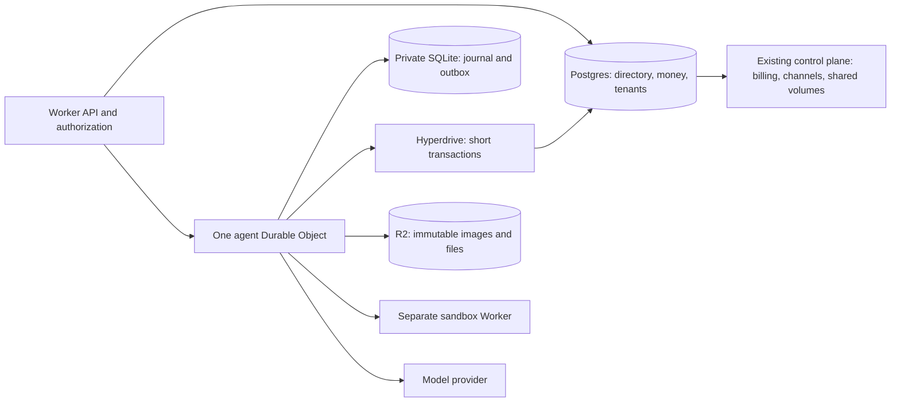

<!-- Generated by studies/build-hybrid.mjs from hybrid-*.md sections. -->

# camelRun hybrid on Workers: design study

**Recommendation: continue a bounded hybrid pilot; do not migrate production yet.**
One Durable Object per agent is a good fit for its journal and execution. Keep
Postgres as the authority for money, tenants, credentials, provider integrations,
usage and administration. The local spike validates real schema transactions
from a DO. It does not prove that a geographically remote DO can cheaply make
many sequential SQL calls, or that the remaining migration is small.

This branch builds on draft [#635](https://github.com/qaml-ai/run/pull/635),
`codex/cf-prototype-2`, source baseline `7d991fe26676`. Read [README.md](../README.md)
and [FEASIBILITY.md](FEASIBILITY.md) for the prototype contract and earlier
measurements. Nothing here changes `src/`, `sandbox/`, `infra/` or main. All
Postgres data used by this study is synthetic and local. Cloud resources are
restricted to the owned `camelrun-proto-*` image experiment and removed afterward.

The October 15 credits outage is a constraint supplied by the CTO for this
study, not a freshly investigated incident. No production database or AWS
operation was used to re-investigate it. The design avoids a D1 money rewrite:
D1 or multiple account/agent DOs would add distributed financial transitions
without making their relational invariants easier to enforce.



The drawing is a proposed target, not a deployed integration. During coexistence,
PG's directory names each agent's backend and generation. An agent DO may cache
configuration, but must not invent tenant authorization or financial authority.
The existing Node control plane continues to run the services that have not been
ported; keeping Postgres does not automatically mean those services can run
unchanged inside a Worker.

The full audit and measured evidence follow in order. Standalone section files
and raw data beside this report support review and reproduction.

## 1. Table map and transaction seams

Audited against source commit `7d991fe266766ad978b272a445ca02bbbbeb63e9`.
`migrations/` creates **116 distinct tables**, drops **7**, and leaves **109**.
The proposed split is **12 agent DO tables, 96 Postgres tables, 8 deleted**.
Only **one of those eight deletions is new and conditional** (`memory_retirement_guard`): remove it only after all residual ECS hosts stop using memory retirement. Until then it remains in the deployed PG schema; it is absent from the new DO agent path.
The other seven were already removed by existing migrations and are not savings.
`schema_migrations` is created by `src/db.ts`, outside `migrations/`; retain it
in Postgres, and give each DO an independent local schema version.

This intentionally conservative target moves agent execution and its hot state,
not every row containing an `agent` column. It keeps the existing shared-volume,
voice and external computer services during the hybrid rollout. Thus
`runtime_nodes`, `actor_owners`, `log_records`, GC and pins remain for those
services and for old agents until migration completes. They cease to be a
requirement of **new agent execution**. Moving shared volumes to their own DOs
would be another port, with separate concurrency, metadata and GC work.
Cloudflare does not provide the application's cross-agent quotas, shared file
reachability, invoice reconciliation or external provider session recovery.

The `agents` row remains the authoritative directory: tenant, public id,
backend/locator, generation, revocation/tombstone and administrative projection.
Its mutable execution header, cursors, request state and recovery markers move
into the DO. The table therefore shrinks substantially without disappearing.
`busy_agents` remains a **tenant admission** table, with expiring
reservation/generation fields instead of node/session ownership. Removing that
table without replacing its semantics would permit unlimited parallel paid work.

### Method and limits

[hybrid-table-map.json](hybrid-table-map.json) records creation/drop migrations,
selected source evidence with line numbers, all lexical `src/**/*.ts` references,
classification and boundary tags for each table. The selected evidence and
related callers were read, including transaction wrappers and commit hooks;
lexical references alone are not proof that a module issues SQL (words such as
`agents` and `usage` also appear as ordinary names). The inventory script strips
SQL comments and checks every created name, later drop and selected source line:

```sh
node backends/cloudflare/studies/check-table-map.mjs
node backends/cloudflare/studies/check-table-map.mjs backends/cloudflare/docs/hybrid-hyperdrive-results.json
```

The second command also checks the actual local PostgreSQL catalog after the
Hyperdrive spike applied all 112 migrations: all 109 live names match exactly
(plus the runner's `schema_migrations`). No production query was made.
The ownership and transaction decisions remain a static code audit.
Dynamic Pi SQL uses a table-name mapping in
`src/pi-durable/storage.ts`, so its eight tables must be followed through that
adapter rather than searched only for literal INSERT statements. A future
migration must also inventory object-storage logs/blobs, not merely SQL tables.

### Boundary tags

`USAGE`, `INPUT` and `PURGE` contain observed **mixed-class writes in one current
transaction**. `FENCE` is a current cross-class locking dependency, not a claim
that ownership rows are changed in every journal transaction. `CHILD`, `REGISTRY`,
`CHANNEL`, `FILES`, `SCHEDULE` and `ADMISSION` include object boundaries or
already-separate operations; they are listed separately to avoid inventing
atomicity that the current code does not have. A tag on a table identifies its
participation in that family; it does not imply every member is written by every
transaction in the family.

#### Observed atomic write seams

| Seam | Current code and atomicity | Hybrid protocol and crash behavior |
| --- | --- | --- |
| `USAGE`: journal to financial receipt | `src/pi-durable/storage.ts` calls `commitEffects` inside its Pi batch transaction; `nativeUsageEffect` in `src/client-sessions/spend.ts` inserts `pi_usage_receipts` and increments `agent_spend_limits`. The host journal's `log_records` append can invoke the same spend effects through `src/log-tail.ts`. Entries carrying `usage.billingAttemptId` only update agent spend here; their account charge comes from `model_attempts`, not a second receipt. The receipt consumer in `src/accounts.ts` locks unaccounted receipts and updates `usage`, `workspace_usage`, `usage_flushes`, `credit_ledger`/`credit_accounts`, `credit_spend_minutes` and webhook outboxes in one PG transaction. | Commit the canonical model entry, local agent spend and a **new DO outbox record** in one SQLite transaction. Stable identity is `(public_agent_id, backend_generation, entry_id, accounting_kind)` with payload hash and an explicit immutable usage revision. Deliver through Hyperdrive to a PG inbox/dedupe key, then run the existing financial updates and mark accounted **in that one PG transaction**. ACK only after PG commit; delete/mark the DO outbox after ACK. Lost ACK retries the identical key and hash, never adds a second charge. Keep the existing `pi_usage_receipts` table as the PG inbox, with a generation-aware unique key for imported agents. Tracked attempt events must settle only through `model_attempts`; untracked usage uses the receipt inbox. Preserve this mutually exclusive charge path so the same model response is not billed by both consumers. Never read eventual account totals to decide whether to start an unreserved paid call. |
| `INPUT`: human/tool request and webhooks | `src/inputs.ts` creates `agent_inputs` and calls `enqueueEvents` inside `underClaim`; `settle` updates the answer with a CAS and enqueues `input.resolved` in the same transaction. Multiple input answers can settle atomically in one batch. | Put pending inputs, immutable answer CAS, wake marker and event outbox in one DO transaction. Deliver webhook/inbox projection by stable input/event id and generation; PG inserts `webhook_deliveries` idempotently. A PG projection may lag, but cannot authorize or override a DO answer. Answer routes resolve directory → DO and compare expected input revision; a repeated same answer succeeds and a different answer conflicts. The tenant-wide inbox is a new PG projection, not an unbounded scatter-gather across DOs. |
| `PURGE`: private history and retained shared state | `src/client-sessions.ts` `purge` runs `purgeData`/Pi deletion, `agent_children`, `schedules`, `agent_inputs`, `agent_spend_limits`, `chunk_pins`, `volume_watchers`, email/channel references and the `agents` tombstone in one fenced PG transaction. `discard` likewise deletes the directory and private data together. Object-storage deletes already occur outside SQL's rollback guarantees. `src/account-deletion.ts` finally deletes both DO-bound and PG-bound tenant rows in one SQL cleanup transaction. | First commit PG revocation plus incremented generation and a purge outbox; newly authorized requests and reservations then fail. Already-admitted external effects require cancellation/reconciliation and cannot be recalled atomically. Send generation-fenced purge to the DO, stop/abort work, flush already-incurred usage receipts, delete private state and R2 objects according to retention, and return an idempotent purge receipt. In a final PG transaction delete shared pointers/pins and mark the directory/account deletion complete. **Release pins only after private references cannot be read again.** Failed purge remains visible/retryable; never report physical erasure from the initial revocation. Persist a minimal tombstone at both authorities to reject delayed messages; older-generation receipts need a defined billing-only reconciliation path. |

#### Other boundaries that must be implemented

| Boundary | Current evidence | Concrete hybrid design |
| --- | --- | --- |
| `FENCE`: journal/inputs/schedules vs ownership | `src/pi-durable/storage.ts` locks `actor_owners FOR SHARE` before metadata; `src/inputs.ts`, `src/scheduler.ts`, `src/client-sessions.ts` and volume writes use `underClaim`. PG ownership plus `runtime_nodes` prevents stale ECS writers. These are locking dependencies even where the only modified table moves to the DO. | A new agent DO uses platform single-object execution plus local transaction ordering; do not call PG ownership for every entry. Every new admission/configuration mutation carries the directory backend generation and is rejected if revoked/stale. Settlement of an already admitted call instead checks its stored reservation generation and immutable receipt, even after revocation, and can only reconcile incurred usage; it cannot authorize new work. Existing-agent cutover first freezes/fences the ECS actor and exports at a stable commit cursor; verify import, then CAS the PG directory generation/backend. Never permit simultaneous ECS and DO effects. Shared-volume actors retain existing ownership until their own explicit port. |
| `USAGE`: reserve/dispatch/settle | `src/credit-holds.ts` reserves under `credit_accounts FOR UPDATE`; `src/model-attempts.ts` starts end-user and tenant holds before dispatch and settles attempts, holds, both ledgers, daily/workspace totals and webhook events in PG. The initial end-user hold, tenant hold and attempt insertion are **separate** transactions today; the final settlement is one PG transaction. | Commit a DO attempt intent, then use one Hyperdrive PG transaction to validate identity/generation, lock account/end-user rows in fixed order, create idempotent tenant/end-user holds and the durable attempt. Dispatch only after that commit. Persist provider completion plus settlement outbox locally; settle in one PG transaction, deleting holds and posting revisioned deltas. Persist a `dispatch_started` attempt before provider I/O. Release an unused reservation only with durable proof it never entered dispatch; expiry alone is not that proof. A crash after dispatch intent is **uncertain**, including the intent-to-send gap, and is never automatically refunded or redispatched on timeout. Extend/renew by idempotent operation id while streaming; fail closed before the reserved budget/expiry is exhausted. An expired hold alone is not evidence that a provider did no work. |
| `ADMISSION`: account-wide busy slots | `src/busy-agents.ts` holds a tenant advisory transaction lock, evaluates paid tier, counts live `runtime_nodes`-backed rows and inserts `busy_agents`. A DO only serializes its own agent, not sibling agents. | Keep PG admission under the tenant lock, using stable reservation id + backend generation, expiry and conditional renew/release. Renew before accepting more paid work; after lost renewal stop dispatch and reconcile outstanding work. Old ECS heartbeat rows and new DO reservations both count during rollout. Expiry must be longer than the bounded unrenewed dispatch period; a recovered old reservation is reconciled rather than treated as a free extra slot. |
| `CHILD`: parent ↔ child ↔ root | `src/client-sessions/children.ts` stores child handles before sending prompts, records end/resume rows together, and increments the parent's `agent_spend_limits` with a late completion in one transaction. Both move to the **parent** DO. Root-hour `agent_wakes` is a separate PG counter, not in that transaction. | Parent commits child intent + reserved child budget + send outbox locally. Child accepts `(parent_id, spawn_id)` once and stores the validated parent reply address/lineage durably; replies carry immutable completion id/cost/revision. Parent records completion, marks notification and releases/debits budget in one local transaction. Stable `child_<request_id>` delivery stays idempotent. Root-wide wake admission remains a PG atomic increment keyed by root/hour and a dedupe token so a retransmission cannot consume twice. Child's local journal and parent's journal never share a transaction. |
| `REGISTRY`: agent creation/configuration vs directory | `src/client-sessions.ts` creates `agents` and inherited `computer_connections` in one PG transaction. Configuration/mount/workspace writes are not one all-enclosing transaction today. | PG directory create + inherited connection snapshot + provisioning outbox commit together. Initial DO create is idempotent by public id/generation/config hash; directory becomes ready only after ACK. Later configuration commands carry monotonically increasing version and immutable payload hash; DO accepts in order and emits an applied projection. Revoke at PG first; strict authorization uses PG generation, not stale projection. User-facing mutable settings need one named authority, not last-writer-wins copies. |
| `CHANNEL`: provider inbox/outbox vs agent turn | `src/channels.ts` commits provider dedupe/counters/outbox and channel mappings in PG; delivery to an agent and outgoing provider calls are already outside that transaction. Email metadata and managed Discord setup also mutate these PG tables. | Keep provider ingestion transaction and durable `channel_items`; send a stable provider-message id as the DO request id and ACK after the DO journal accepts it. DO completion outbox updates the PG channel item once, then existing sender retries provider delivery using provider-supported idempotency. Uncertain non-idempotent external sends need reconciliation, not an exactly-once claim. |
| `SCHEDULE`: wake vs report email | `src/scheduler.ts` writes schedule state under an ownership lock; dispatch, `schedule_deliveries` insertion and next-due/delete updates are separate operations today. | DO alarm multiplexes earliest due schedule, input expiry, outbox retry and lifecycle wake. One local transaction creates stable `(schedule_id, scheduled_due_at)` request + optional delivery outbox and advances next due. PG delivery insertion dedupes that key, then mail worker runs normally. Alarm retry cannot double-submit; cancellation/revision checks happen at local commit. Preserve timezone/DST/calendar semantics and catch-up policy. |
| `FILES`: local history vs shared file graph | `src/volumes.ts` publishes immutable blobs, tracks `chunk_touches`, `chunk_pins`, `volume_snapshots` and `volume_watchers`; `src/storage-gc.ts` checks reachable roots and grace periods. File/pin publication and journal insertion are not one transaction everywhere today. | Keep shared metadata/GC in PG and bulk bytes in object storage/R2. Pin an immutable hash with idempotent `(agent,generation,entry,hash)` **before** publishing its DO reference; if local commit fails, leave the extra pin for a conservative sweeper. Release through a DO outbox only after the reference is deleted. Check content hash on reads and preserve fork/snapshot pins. R2 lifecycle rules can expire known temporary prefixes, but cannot infer live references or replace general GC. Shared writes need volume authority/version CAS and durable watcher delivery. |

**No session-pooling shortcut.** `src/log-tail.ts` holds a session-level advisory
lock across blob compaction; `src/computers/service.ts` holds one across provider
operations; `src/db.ts` uses a dedicated LISTEN connection and migration advisory
locks. These implementations are not portable unchanged to a transaction-pooled
Hyperdrive connection. Keep those adapters on their existing control-plane
service initially, or replace long session locks with short transactional
reservation/version state machines. `pg_advisory_xact_lock` inside an explicit
transaction is a different mechanism. Do not hold a PG transaction open across
an entire model generation, R2 stream or external computer API call.

### Complete migration-created table map

`Agent DO` means the conceptual record moves to SQLite, not that the existing
Postgres DDL runs unchanged there. PG is Postgres. Source links name the selected
consumer; JSON records all literal references. `Already dropped` rows are kept
in the audit because they occur in migration history.

| Table | Destination | Reason and selected source | Boundaries |
| --- | --- | --- | --- |
| `runtime_nodes` | Postgres | Retain for shared-volume and legacy host leases during coexistence; agent DO routing no longer writes it. [src/ownership.ts](../../../src/ownership.ts#L184) | FENCE |
| `actor_owners` | Postgres | Retain volume ownership and migration fencing; DO agents replace their actor rows, not the shared-volume authority. [src/ownership.ts](../../../src/ownership.ts#L32) | FENCE |
| `tenants` | Postgres | Identity, signup eligibility and billing mode stay with relational account authority. [src/accounts.ts](../../../src/accounts.ts#L5) | — |
| `provider_keys` | Postgres | Encrypted tenant provider credentials and account deletion stay centrally scoped. [src/accounts.ts](../../../src/accounts.ts#L18) | — |
| `api_tokens` | Postgres | Tenant token lookup, revocation and listing require one account authority. [src/accounts.ts](../../../src/accounts.ts#L18) | — |
| `usage` | Postgres | Tenant/day/model financial totals commit with ledger and delivery records. [src/accounts.ts](../../../src/accounts.ts#L16) | USAGE |
| `agents` | Postgres | Keep tenant directory, authorization, tombstones and backend generation; move hot header/runtime fields into the agent DO. [src/client-sessions.ts](../../../src/client-sessions.ts#L142) | REGISTRY, PURGE, FENCE |
| `schedules` | Agent DO | Per-agent schedule definitions and next due time fit local SQLite plus a multiplexed alarm; calendar/retry logic remains. [src/scheduler.ts](../../../src/scheduler.ts#L11) | FENCE, SCHEDULE, PURGE |
| `channels` | Postgres | Tenant integration configuration and credentials are shared by many agents. [src/channels.ts](../../../src/channels.ts#L29) | — |
| `channel_conversations` | Postgres | Provider conversation-to-agent identity must remain unique across Workers. [src/channels.ts](../../../src/channels.ts#L30) | CHANNEL, PURGE |
| `channel_agents` | Postgres | Reverse channel binding and access filters belong with provider conversation identity. [src/channels.ts](../../../src/channels.ts#L31) | CHANNEL, PURGE |
| `channel_items` | Postgres | Inbound/outbound delivery outbox must survive retries and coordinate shared provider rate limits. [src/channels.ts](../../../src/channels.ts#L32) | CHANNEL |
| `channel_seen` | Postgres | Provider message deduplication commits with durable inbound delivery. [src/channels.ts](../../../src/channels.ts#L33) | CHANNEL |
| `channel_counts` | Postgres | Channel-wide rate counters must cover all agent objects. [src/channels.ts](../../../src/channels.ts#L34) | CHANNEL |
| `volumes` | Postgres | Shared-volume identity, tenant access, tombstones and retention remain relational. [src/volumes.ts](../../../src/volumes.ts#L18) | PURGE, FENCE |
| `volume_snapshots` | Postgres | Shared snapshot metadata and pin policy are not supplied by R2. [src/volumes.ts](../../../src/volumes.ts#L19) | FILES |
| `volume_watchers` | Postgres | Shared volume-to-agent subscriptions span objects and require delivery reconciliation. [src/volumes.ts](../../../src/volumes.ts#L19) | FILES, PURGE, FENCE |
| `log_records` | Postgres | Retain shared-volume hot log tails; agent host journals move to SQLite and shrink this mixed table. [src/log-tail.ts](../../../src/log-tail.ts#L9) | USAGE, PURGE, FENCE |
| `definitions` | Postgres | Reusable tenant definitions, revisions and list/filter behavior span agents. [src/definitions.ts](../../../src/definitions.ts#L22) | — |
| `credit_ledger` | Postgres | Append-only money movements and anti-duplication keys remain atomic with account balance. [src/billing.ts](../../../src/billing.ts#L20) | USAGE |
| `credit_accounts` | Postgres | Locked balance and paid-credit totals are the tenant spending authority. [src/billing.ts](../../../src/billing.ts#L22) | USAGE |
| `usage_flushes` | Postgres | Batch deduplication commits together with usage, ledger, workspace and webhooks. [src/accounts.ts](../../../src/accounts.ts#L40) | USAGE |
| `billing_jobs` | Postgres | Durable billing/storage accrual jobs are account-wide financial work. [src/billing.ts](../../../src/billing.ts#L745) | — |
| `signing_keys` | Postgres | Persistent signing-key rotation and credential verification belong to control plane. [src/identity.ts](../../../src/identity.ts#L94) | — |
| `credit_spend_minutes` | Postgres | Per-tenant hourly credit allowance must remain in the money transaction. [src/billing.ts](../../../src/billing.ts#L98) | USAGE |
| `storage_usage` | Postgres | Account/volume storage totals drive billing and need reconciliation with retained objects. [src/storage-usage.ts](../../../src/storage-usage.ts#L27) | — |
| `agent_inputs` | Agent DO | Pending human/tool input, answers and expiry belong beside the paused journal; tenant inbox needs a PG projection. [src/inputs.ts](../../../src/inputs.ts#L15) | INPUT, FENCE, PURGE |
| `key_scope_providers` | Postgres | Provider access scopes are tenant policy shared across agents. [src/key-scopes.ts](../../../src/key-scopes.ts#L109) | — |
| `agent_spend_limits` | Agent DO | Per-agent limit, reset epoch and spent amount commit with its journal; this is not the tenant credit ledger. [src/client-sessions.ts](../../../src/client-sessions.ts#L1099) | USAGE, CHILD, PURGE |
| `usage_webhooks` | Postgres | Legacy tenant usage endpoint configuration stays at financial delivery authority. [src/webhooks.ts](../../../src/webhooks.ts#L80) | USAGE |
| `usage_webhook_outbox` | Postgres | Legacy usage deliveries are committed with financial totals and retry independently. [src/webhooks.ts](../../../src/webhooks.ts#L78) | USAGE |
| `agent_history_chunks (already dropped)` | Delete | Already dropped by 095_drop_history_index.sql; no current src consumer. This is not a new hybrid saving. [migrations/095_drop_history_index.sql](../../../migrations/095_drop_history_index.sql#L1) | — |
| `agent_history_index (already dropped)` | Delete | Already dropped by 095_drop_history_index.sql; no current src consumer. This is not a new hybrid saving. [migrations/095_drop_history_index.sql](../../../migrations/095_drop_history_index.sql#L1) | — |
| `tenant_cors_origins (already dropped)` | Delete | Already dropped by 023_drop_tenant_cors_origins.sql; no current src consumer. This is not a new hybrid saving. [migrations/023_drop_tenant_cors_origins.sql](../../../migrations/023_drop_tenant_cors_origins.sql#L2) | — |
| `webhook_endpoints` | Postgres | Tenant subscriptions and encrypted signing secrets are shared configuration. [src/webhooks.ts](../../../src/webhooks.ts#L74) | USAGE, INPUT, CHANNEL |
| `webhook_deliveries` | Postgres | Durable globally deduplicated webhooks and retry state stay at delivery authority. [src/webhooks.ts](../../../src/webhooks.ts#L72) | USAGE, INPUT, CHANNEL |
| `idempotency_keys` | Postgres | API-wide request deduplication spans account/control-plane operations. [src/idempotency.ts](../../../src/idempotency.ts#L32) | — |
| `chunk_touches` | Postgres | Shared immutable chunk last-use tracking prevents R2 garbage collection racing publication. [src/volumes.ts](../../../src/volumes.ts#L838) | FILES |
| `chunk_pins` | Postgres | Transcript FileRefs can outlive mutable volume entries; R2 has no cross-object reference counting. [src/volumes.ts](../../../src/volumes.ts#L852) | FILES, PURGE |
| `gc_candidates` | Postgres | Two-pass grace-period candidates remain needed for shared R2 chunk deletion. [src/storage-gc.ts](../../../src/storage-gc.ts#L49) | FILES |
| `storage_gc` | Postgres | Tenant GC coordination remains while a shared-volume service owns chunk reachability. [src/storage-gc.ts](../../../src/storage-gc.ts#L95) | FILES |
| `model_providers` | Postgres | Tenant custom model endpoints and encrypted credentials must be centrally managed. [src/model-providers.ts](../../../src/model-providers.ts#L143) | — |
| `email_threads` | Postgres | Email threading headers and sender identities are provider conversation metadata. [src/channels-email.ts](../../../src/channels-email.ts#L24) | CHANNEL, PURGE |
| `email_messages` | Postgres | Provider Message-ID deduplication and references stay with shared email delivery. [src/channels-email.ts](../../../src/channels-email.ts#L25) | CHANNEL, PURGE |
| `oauth_grants` | Postgres | OAuth clients/scopes and grant revocation are account authority. [src/oauth.ts](../../../src/oauth.ts#L130) | — |
| `oauth_tokens` | Postgres | Refresh/access token lifecycle must preserve atomic rotation and revocation. [src/oauth.ts](../../../src/oauth.ts#L130) | — |
| `starting_credit_decisions` | Postgres | Immutable identity eligibility decisions prevent repeated free credit after deletion. [src/billing.ts](../../../src/billing.ts#L417) | — |
| `billing_alert_settings` | Postgres | Account threshold settings stay with balance and notification policy. [src/billing-alerts.ts](../../../src/billing-alerts.ts#L57) | — |
| `billing_recipients` | Postgres | Verified billing recipients authorize financial and scheduled emails. [src/billing-alerts.ts](../../../src/billing-alerts.ts#L58) | — |
| `billing_email_suppressions` | Postgres | Email-level suppression spans tenants and must remain durable. [src/billing-alerts.ts](../../../src/billing-alerts.ts#L59) | — |
| `billing_confirmation_limits` | Postgres | Confirmation rate limits coordinate tenant/email recipient verification. [src/billing-alerts.ts](../../../src/billing-alerts.ts#L230) | — |
| `billing_events` | Postgres | Only deletion cleanup references it today; retain compatibility until a separate dead-schema audit proves safe removal. [src/account-deletion.ts](../../../src/account-deletion.ts#L54) | — |
| `billing_email_outbox` | Postgres | Durable financial email queue and idempotency stay with billing policy. [src/billing-mailer.ts](../../../src/billing-mailer.ts#L102) | — |
| `billing_stripe_refunds` | Postgres | Stripe refund deduplication and ledger correction stay one money transaction. [src/billing.ts](../../../src/billing.ts#L685) | — |
| `billing_stripe_customers` | Postgres | Stripe customer identity is tenant-level payment state. [src/billing-payments.ts](../../../src/billing-payments.ts#L42) | — |
| `billing_checkouts` | Postgres | Checkout eligibility, completion and deduplication stay with ledger settlement. [src/billing-payments.ts](../../../src/billing-payments.ts#L84) | — |
| `billing_checkout_cutover` | Postgres | Legacy checkout cutoff is shared payment migration state, not agent state. [src/billing-payments.ts](../../../src/billing-payments.ts#L125) | — |
| `billing_auto_settings` | Postgres | Automatic funding thresholds and Stripe payment settings remain relational. [src/auto-topup.ts](../../../src/auto-topup.ts#L34) | — |
| `billing_auto_quotes` | Postgres | Price/fee quotes protect automatic funding confirmation. [src/auto-topup.ts](../../../src/auto-topup.ts#L62) | — |
| `billing_auto_attempts` | Postgres | Automatic invoice/charge retries and account deletion coordination need one authority. [src/auto-topup.ts](../../../src/auto-topup.ts#L38) | — |
| `help_requests` | Postgres | Tenant support request deduplication and email delivery stay control-plane work. [src/help.ts](../../../src/help.ts#L207) | — |
| `card_checks` | Postgres | Card fingerprint eligibility and awards must remain atomic and survive account deletion. [src/card-credit.ts](../../../src/card-credit.ts#L17) | — |
| `account_deletions` | Postgres | A durable erasure saga tracks tenant denial, per-agent purge and retained legal/accounting records. [src/account-deletion.ts](../../../src/account-deletion.ts#L23) | PURGE |
| `discord_installations` | Postgres | Managed Discord installation identity is shared across tenant agents. [src/discord-managed.ts](../../../src/discord-managed.ts#L221) | — |
| `discord_server_bindings` | Postgres | Server-to-tenant/channel uniqueness must be globally serialized. [src/discord-managed.ts](../../../src/discord-managed.ts#L221) | — |
| `discord_setup_attempts` | Postgres | Server setup nonce/state and retries belong beside its binding. [src/discord-managed.ts](../../../src/discord-managed.ts#L262) | — |
| `discord_account_links (already dropped)` | Delete | Already dropped by 047_drop_discord_account_links.sql; no current src consumer. This is not a new hybrid saving. [migrations/047_drop_discord_account_links.sql](../../../migrations/047_drop_discord_account_links.sql#L3) | — |
| `discord_setup_cooldowns` | Postgres | Provider server setup throttles are shared across accounts. [src/discord-managed.ts](../../../src/discord-managed.ts#L196) | — |
| `busy_agents` | Postgres | Tenant-wide concurrent-run admission is not supplied by DO single-threading; replace node heartbeat columns with expiring reservations. [src/busy-agents.ts](../../../src/busy-agents.ts#L27) | ADMISSION |
| `rate_limits` | Postgres | Multi-Worker account/IP/model request limits require a shared authority. [src/rate-limits.ts](../../../src/rate-limits.ts#L239) | — |
| `telemetry_exporters (already dropped)` | Delete | Already dropped by 094_drop_telemetry_exporters.sql; no current src consumer. This is not a new hybrid saving. [migrations/094_drop_telemetry_exporters.sql](../../../migrations/094_drop_telemetry_exporters.sql#L3) | — |
| `admin_github_bindings` | Postgres | Admin GitHub numeric identity binding protects renamed/reused logins. [src/accounts.ts](../../../src/accounts.ts#L200) | — |
| `billing_disputes` | Postgres | Stripe disputes, balance effects and resolution deduplication remain financial state. [src/billing.ts](../../../src/billing.ts#L333) | — |
| `console_sessions` | Postgres | Console authentication and session revocation are account-scoped. [src/console-auth.ts](../../../src/console-auth.ts#L14) | — |
| `tenant_passwords` | Postgres | Password hashes, reset versions and account lockouts stay with identity authority. [src/passwords.ts](../../../src/passwords.ts#L75) | — |
| `account_email_links` | Postgres | Sign-in/reset/verification links are one-time account credentials. [src/email-accounts.ts](../../../src/email-accounts.ts#L12) | — |
| `journey_accounts` | Postgres | Customer lifecycle/account acquisition aggregates are cross-agent analytics. [src/journey.ts](../../../src/journey.ts#L22) | — |
| `journey_milestones` | Postgres | Idempotent signup/payment/product milestones stay with account events. [src/journey.ts](../../../src/journey.ts#L240) | — |
| `journey_state` | Postgres | Lifecycle delivery/cursor state belongs to shared customer messaging. [src/journey.ts](../../../src/journey.ts#L665) | — |
| `journey_lost_signups` | Postgres | Rejected signup attribution is account acquisition state. [src/journey.ts](../../../src/journey.ts#L35) | — |
| `journey_outbox` | Postgres | Lifecycle email/notification delivery remains a durable shared outbox. [src/journey.ts](../../../src/journey.ts#L13) | — |
| `agent_children` | Agent DO | Parent-owned child handles, budgets and delivery state fit its SQLite; child-to-parent notification is an idempotent message. [src/client-sessions/children.ts](../../../src/client-sessions/children.ts#L90) | CHILD, PURGE, FENCE |
| `agent_wakes` | Postgres | Root-chain hourly wake counter covers different agent DOs; retain atomic shared increments. [src/client-sessions/children.ts](../../../src/client-sessions/children.ts#L520) | CHILD |
| `model_attempts` | Postgres | Attempt identity, uncertain provider outcomes and settled charge revisions stay with money reconciliation. [src/model-attempts.ts](../../../src/model-attempts.ts#L117) | USAGE |
| `end_user_settings` | Postgres | Tenant markup/allowance policy belongs to relational end-user financial authority. [src/end-user-credits.ts](../../../src/end-user-credits.ts#L279) | USAGE |
| `end_users` | Postgres | Locked end-user balances and overrides are shared across the tenant agents. [src/end-user-credits.ts](../../../src/end-user-credits.ts#L15) | USAGE |
| `end_user_ledger` | Postgres | Idempotent allowance/paid movements stay with end-user balance settlement. [src/end-user-credits.ts](../../../src/end-user-credits.ts#L459) | USAGE |
| `end_user_days` | Postgres | Daily allowance consumption must be atomic across agent calls. [src/end-user-credits.ts](../../../src/end-user-credits.ts#L16) | USAGE |
| `end_user_holds` | Postgres | In-flight end-user spending reservations are cross-agent financial state. [src/end-user-credits.ts](../../../src/end-user-credits.ts#L234) | USAGE |
| `voice_sessions` | Postgres | Voice room/session ownership and reconnect/provider lifecycle span agents and transport hosts. [src/voice-sessions.ts](../../../src/voice-sessions.ts#L207) | — |
| `elevenlabs_voices` | Postgres | Shared custom voice cache/identities are keyed by provider account, not one agent. [src/voice/realtime/elevenlabs.ts](../../../src/voice/realtime/elevenlabs.ts#L115) | — |
| `pi_durable_metadata` | Agent DO | Per-agent record allocator, commit sequence and history ordinals need only local SQLite transactions. [src/pi-durable/storage.ts](../../../src/pi-durable/storage.ts#L81) | USAGE, FENCE, PURGE |
| `pi_durable_record_ids` | Agent DO | The record-type/id namespace is private to one agent journal. [src/pi-durable/storage.ts](../../../src/pi-durable/storage.ts#L81) | USAGE, FENCE, PURGE |
| `pi_durable_conversations` | Agent DO | Conversation ownership and forks are private journal state. [src/pi-durable/storage.ts](../../../src/pi-durable/storage.ts#L82) | USAGE, FENCE, PURGE |
| `pi_durable_entries` | Agent DO | Canonical model/tool entries and history placement belong beside execution; keep image bytes outside large rows. [src/pi-durable/storage.ts](../../../src/pi-durable/storage.ts#L82) | USAGE, FENCE, PURGE |
| `pi_durable_tasks` | Agent DO | Task lifecycle and wake state are private to the agent and recovered by its alarm. [src/pi-durable/storage.ts](../../../src/pi-durable/storage.ts#L83) | USAGE, FENCE, PURGE |
| `pi_durable_submissions` | Agent DO | Queued request acceptance/deduplication must commit with the journal that executes it. [src/pi-durable/storage.ts](../../../src/pi-durable/storage.ts#L83) | USAGE, FENCE, PURGE |
| `pi_durable_documents` | Agent DO | Durable tool/input/session documents are private journal state. [src/pi-durable/storage.ts](../../../src/pi-durable/storage.ts#L84) | USAGE, FENCE, PURGE |
| `pi_durable_document_revisions` | Agent DO | Document base/delta revisions need atomicity only with their parent journal. [src/pi-durable/storage.ts](../../../src/pi-durable/storage.ts#L84) | USAGE, FENCE, PURGE |
| `pi_usage_receipts` | Postgres | Retain as billing inbox/deduplication receipt; a new DO outbox replaces its current atomic journal insertion. [src/accounts.ts](../../../src/accounts.ts#L585) | USAGE, PURGE |
| `pi_sweep (already dropped)` | Delete | Already dropped by 084_drop_pi_sweep.sql; no current src consumer. This is not a new hybrid saving. [migrations/084_drop_pi_sweep.sql](../../../migrations/084_drop_pi_sweep.sql#L4) | — |
| `workspaces` | Postgres | These are account organization groups, not per-agent filesystem workspaces. [src/workspaces.ts](../../../src/workspaces.ts#L15) | — |
| `workspace_assignments` | Postgres | Time-versioned membership spans agents and determines historical usage attribution. [src/workspaces.ts](../../../src/workspaces.ts#L32) | USAGE, REGISTRY |
| `workspace_usage` | Postgres | Workspace financial aggregates commit with tenant totals and ledger. [src/workspaces.ts](../../../src/workspaces.ts#L68) | USAGE |
| `schedule_deliveries` | Postgres | Verified email delivery and retry state stays in shared outbox; DO emits a durable delivery command. [src/schedule-mailer.ts](../../../src/schedule-mailer.ts#L25) | SCHEDULE, PURGE |
| `computer_connections` | Postgres | Tenant/provider attachment credentials and child inheritance stay at compute account authority. [src/computers/service.ts](../../../src/computers/service.ts#L45) | REGISTRY |
| `computer_leases` | Postgres | External/BYOC machine lifetimes and billable history remain even when agent hosting moves. [src/computers/service.ts](../../../src/computers/service.ts#L49) | — |
| `computer_commands` | Postgres | Durable external computer command identity/recovery is not replaced by agent DO ownership. [src/computers/service.ts](../../../src/computers/service.ts#L199) | — |
| `computer_operations` | Postgres | Provider effect idempotency and uncertain outcomes remain at compute authority. [src/computers/service.ts](../../../src/computers/service.ts#L164) | — |
| `memory_retirement_guard` | Delete | Retire with ECS memory-retirement behavior; delete the PG table only after every residual host stops using that feature. [src/ownership.ts](../../../src/ownership.ts#L427) | FENCE |
| `voice_recordings` | Postgres | Recording consent, room metadata and object retention span transport/provider lifecycles. [src/voice-sessions.ts](../../../src/voice-sessions.ts#L243) | — |
| `computer_transfers (already dropped)` | Delete | Already dropped by 100_drop_computer_transfers.sql; no current src consumer. This is not a new hybrid saving. [migrations/100_drop_computer_transfers.sql](../../../migrations/100_drop_computer_transfers.sql#L1) | — |
| `credit_holds` | Postgres | Tenant reservations serialize under the same account row lock as shared money. [src/credit-holds.ts](../../../src/credit-holds.ts#L20) | USAGE |
| `managed_computers` | Postgres | Provider machine allocation, paid lifetime and recovery remain compute account authority. [src/computers/managed.ts](../../../src/computers/managed.ts#L200) | — |
| `computer_blocks` | Postgres | Account abuse/concurrency blocks apply across all agent objects. [src/computers/managed.ts](../../../src/computers/managed.ts#L280) | — |
| `end_user_lots` | Postgres | Paid credit lots, expiry and write-offs stay in the end-user settlement transaction. [src/end-user-credits.ts](../../../src/end-user-credits.ts#L232) | USAGE |

## 2. Code removed and newly required

Source baseline: `7d991fe26676` (the #635 prototype base). Counts are physical
TypeScript lines, including comments and blank lines, with no dependencies,
generated code, tests, Rust/C, infra or documentation counted. These are estimates
of a completed **agent-host cutover**, not changes made by this study. Keeping ECS
agents active during a phased rollout adds the new backend before deleting anything.

Run `node backends/cloudflare/spikes/design/code-estimate.mjs` from the repository
root to verify source counts and recompute the arithmetic. The JSON beside it
records every input and assumed removal range. Each file is counted once; ranges
for `node.ts` and `client-sessions.ts` include their parking, routing and lifecycle
code, so those are not counted again as separate modules.

| Source module | Current lines | Lines retired, estimate | Why / what remains |
| --- | ---: | ---: | --- |
| `src/ownership.ts` | 495 | 80–150 | Agent claims and routing leave; volume/channel/voice ownership remains. |
| `src/node.ts` | 1,811 | 400–650 | Agent startup, routing, orphan scans and retirement wiring shrink; control-plane services remain. |
| `src/node-config.ts` | 211 | 30–60 | Remove agent-host capacity and retirement settings only. |
| `src/supervisor.ts` | 500 | 350–500 | Process handles, admission, watchdog and storage RPC leave; export helpers need relocation. |
| `src/agent-child.ts` | 42 | 42–42 | No per-agent Node child entrypoint. |
| `src/rpc.ts` | 102 | 50–102 | Agent IPC leaves; shared Rpc consumers need porting before whole-file deletion. |
| `src/client-sessions.ts` | 2,845 | 650–1,050 | Remove host capacity, lease, orphan, handoff and local lifecycle paths; request semantics remain. |
| `src/agent-host.ts` | 1,370 | 250–450 | Drop host-specific boot/IPC and replace with PiHarness; model/tool policy remains. |
| `src/v8-exec.ts` | 156 | 156–156 | Replace process pool/prespawn/launch with separate sandbox Worker. |
| `src/codemode-pi-launcher.ts` | 175 | 175–175 | Replace V8 frame bridge and process admission with remote codemode adapter. |
| `src/sandbox.ts` | 83 | 0–0 | Confined is also the parser security boundary: preserve unless parser is independently replaced. |
| `src/sandbox-wire.ts` | 49 | 0–0 | Parser framing remains; not exclusively v8-exec. |
| `src/memory-retirement.ts` | 49 | 0–49 | Agent pressure logic can leave; retain while control-plane fleet still uses it. |
| `src/process-memory.ts` | 16 | 0–16 | Same conditional removal as node memory guard. |
| `src/ecs.ts` | 185 | 0–80 | Agent-specific protection/retirement shrinks; service addressing and metrics may remain. |
| `src/history-pages.ts` | 304 | 120–220 | Replace PG ordinal access and legacy fill; preserve bounded paging contract. |
| `src/pi-durable/storage.ts` | 1,621 | 900–1,300 | Agent PG adapter/storage RPC becomes DO storage; hooks and compatibility need replacement. |
| `src/pi-durable/ordinals.ts` | 331 | 40–100 | Remove PG lazy-fill plumbing; ordinal/cursor contract remains. |
| `src/pi-durable/reclaim.ts` | 154 | 80–120 | No distributed agent PG journal sweep; keep retention behavior. |
| `src/pi-durable/host-journal.ts` | 263 | 50–100 | Host bridges shrink; host message and run completion semantics remain. |
| `src/scheduler.ts` | 216 | 60–100 | PG polling and claims become an alarm multiplexer; recurrence/retry logic remains. |
| `src/busy-agents.ts` | 107 | 0–25 | Tenant-wide admission remains; replace runtime-node liveness with durable permits. |
| `src/log-tail.ts` | 157 | 30–60 | Agent hot tails leave; shared-volume compaction remains. |
| `src/storage-gc.ts` | 115 | 0–0 | R2 still needs reachability/liveness for shared immutable chunks. |
| `src/gc-verify.ts` | 94 | 0–0 | Integrity and erasure verification still needed. |
| `src/pin-backfill.ts` | 86 | 0–0 | Historical retention/import tooling remains during migration. |

The 11,537-line selected surface loses an estimated **3,463–5,505 lines**.
The existing prototype is **1,062 lines** across `src/` and `codemode/`.
Neither Pi nor Cloudflare package internals are counted as our source, but moving
code to a dependency transfers maintenance risk; it does not eliminate it.

| Newly written beyond the existing prototype | Estimated lines |
| --- | ---: |
| Hyperdrive billing bridge, usage outbox, dedupe and reconciliation | 600–1,000 |
| Bounded history, image-reference adapter, cache lifecycle | 500–900 |
| Directory routing, migration export/import, generation fencing | 450–800 |
| Policy/tool adapters, alarm multiplexer and external-effect state machines | 600–1,200 |
| Observability, integrity and erasure adapters | 150–300 |

That adds **3,362–5,262 lines including the prototype**, for an estimated net
**2,143 lines fewer to 1,799 lines more**. A central arithmetic scenario is about
172 fewer lines; it is not a point prediction. The defensible benefit is removing
agent ownership/host coordination from our operating model, not promising a large
code-count reduction. All ranges are engineering judgment based on responsibilities
read in the listed files, not measurements of an implemented migration. Tests and
throwaway migration scripts add further code and are excluded on both sides; the
production export/import adapter is included in the directory/migration estimate.

### Where the simplification stops

- **Leases and routing:** `Ownership` also fences shared volume writes, channel
  connections and voice sessions. Agent address discovery and heartbeats leave
  the agent path; the module and `runtime_nodes`/`actor_owners` cannot disappear
  wholesale while those services remain. The retained Node control plane needs
  a smaller fleet, not zero fleet operations.
- **Parking and memory:** `ClientSessions.makeRoom`, `resumeOrphans`, `handOff*`,
  `releaseIdle`, `tick`, `unload`, the supervisor and ECS retirement wiring lose
  their role for DO agents. A DO still needs bounded context, durable continuation
  and quiet waits. A live Promise, SSE stream or remote human-input wait may keep
  it billed; automatic idle eviction is not an application-level parking protocol.
- **History:** `history-pages.ts` already reads bounded ordinal ranges and refuses
  oversized reads. Its API semantics, stable cursors, byte limits, fork cuts,
  retention and export remain necessary. The prototype's full-materialization
  implementation is a regression to fix before migration, not a deletion saving.
- **Scheduler:** the PG poll/claim loop becomes one alarm per agent that multiplexes
  user schedules, continuation, outbox retry and expiry. Calendar/DST rules,
  occurrence IDs, cancellation, retry ceilings and email delivery remain ours.
- **Code execution:** `v8-exec.ts` and `codemode-pi-launcher.ts` can leave the agent
  backend after remote-codemode parity, but the remote sandbox still needs quotas,
  cancellation, output bounds and independent-isolate failure tests. `sandbox.ts`
  also confines image/document parsing today; that security behavior is not free.
- **GC and pins:** R2 stores objects, but does not determine whether agent histories,
  shared volumes and snapshots still refer to them. Retain PG reachability and
  grace periods. Newly introduced image variants need versioned keys, expiry and
  deletion receipts too. Replacing the shared-volume design is separate work.
- **Postgres:** keep account, billing, OAuth, usage, webhook and administration code.
  Hyperdrive is a transaction pool, not a drop-in substitute for session-level
  advisory locks, `LISTEN/NOTIFY`, or a Node `pg.Pool` held indefinitely.

### New behavior to implement, not just new adapters

Use a Postgres agent directory with backend and generation, fencing every
provision/revoke/migrate mutation. An agent DO owns its canonical journal, prompt
queue and local outbox. It must explicitly serialize mutating operations across
external awaits: a single JavaScript thread does not make a whole asynchronous
handler atomic. Put short local transitions in SQLite transactions; do not hold
`blockConcurrencyWhile` or a PG transaction across a model/tool request.

Credits remain a PG authority. Admit a bounded model call using a durable PG
reservation and a persisted dispatch-attempt identity, then run the provider
outside the transaction. A crash after dispatch is uncertain: reconcile the
existing attempt rather than blindly calling the provider again. Commit the canonical
model entry and usage outbox together in SQLite. Apply the receipt and charge
atomically in PG using a stable receipt ID, and acknowledge only after PG commits.
Crash/retry tests must cover every boundary. A hold's expiry is not evidence that
an external call did not happen; reconcile the uncertain outcome before releasing
it. The detailed transaction audit and local spike define the narrower pieces
that are actually verified.

## 3. Hyperdrive and real-schema credit transactions

Measured November 5, 2026. Code: `spikes/hyperdrive/`. Raw samples and the
post-migration catalog: `hybrid-hyperdrive-results.json`.

This verifies a real local workerd Worker calling a SQLite Durable Object,
which uses `pg` through `env.HYPERDRIVE.connectionString` to execute real
Postgres transactions. All **112** repository migration files applied unchanged
to a fresh PostgreSQL **16.15** container. Its catalog has **109** live tables
created by migrations, plus the runner's `schema_migrations` bookkeeping table.
No production connection, database, AWS API or Cloudflare resource was used.

**The local binding is not the deployed Hyperdrive proxy.** Cloudflare documents
that `localConnectionString` connects directly and does not use its connection
pool or query cache. These numbers establish local API/driver/schema feasibility,
not network latency, pool saturation or regional placement in Cloudflare.
[Local development](https://developers.cloudflare.com/hyperdrive/configuration/local-development/).

### Transaction and failure evidence

The DO opens one client per operation, starts `BEGIN`, locks the tenant's
`credit_accounts` row, and checks the durable receipt before modifying credit.
The receipt stores a SHA-256 of tenant, call ID, reservation and final cost;
changed immutable payloads are rejected. Input amounts must be positive safe
integer micro-USD and the final cost must not exceed the requested reservation.
Those validation rules and the account lock enforce the fixture's paid-balance
bound. They are not a production pricing, authorization or account quota system.
The `charge` operation reserves credit and settles it in that same transaction:

1. Read available balance minus live `credit_holds`; refuse if insufficient.
2. Insert the hold, append `credit_ledger` and update `credit_accounts` together
   using a data-modifying CTE.
3. Update `credit_spend_minutes`, insert the UUID into `usage_flushes`, and
   remove the hold; `COMMIT` all these changes or `ROLLBACK` all of them.
4. Close the client in `finally`. No client lives in a DO instance field.

This is a narrow paid-credit proof derived from `src/credit-holds.ts`,
`src/billing.ts:postLedger/accrueUsage` and `src/accounts.ts:flushUsage`.
It is **not** a copy or replacement of the complete billing implementation:
free-credit hourly limits, end-user lots, funding surcharges, pricing, usage
rollups, webhook enqueue and auto-topup remain outside the spike. A production
adapter should reuse those policy contracts and retain one transaction for
their Postgres writes. It must also bind tenant, agent generation, reservation
and receipt identity; the local unauthenticated fixture does not implement that
authorization layer.
The spike's `usage_flushes` row proves transactional deduplication only; it does
not exercise the native Pi usage pipeline. That pipeline distinguishes tracked
`model_attempts` from untracked `pi_usage_receipts`: usage with a
`billingAttemptId` must not be billed again through the receipt path.

| Test | Result |
| --- | --- |
| 60 sequential charges, 7,000 micro-USD each | Balance and sum of ledger both 580,000; spend counter 420,000; no holds left |
| 20 different DOs, same 100,000 balance, each requesting 15,000 | Exactly six committed, fourteen refused, balance 10,000; no overspend |
| 12 different DOs replaying one receipt concurrently | One committed, eleven duplicate results; one debit |
| Same receipt with different cost or reservation | Rejected as payload mismatch |
| Inject exception after ledger, balance, spend, receipt and hold writes | Entire transaction rolled back; retry committed |
| Commit succeeds, then an application error suppresses its acknowledgement | Retry found the receipt and returned duplicate without a second debit; this does not inject a network failure during COMMIT |
| Separate reserve and settle requests | Durable hold between calls; zero idle Postgres transactions; final settlement committed |
| DO A reserves 15,000 of 20,000, DO B requests 10,000 | B refused; failed A settlement preserved the hold; successful 10,000 settlement released the unused 5,000 |

The last test models the useful production boundary: reserve in a short
transaction, commit that reservation, run the provider outside Postgres, then
settle with another short transaction. Never hold an account lock over model
inference. Journal the pending settlement with the canonical DO model entry and
retry its immutable receipt until Postgres acknowledges it. A crash after
Postgres commits but before the DO records its acknowledgement is handled by
that same receipt. This is at-least-once delivery plus deduplication, not an
atomic transaction spanning SQLite and Postgres. Reservation renewal, expiry
versus late settlement, reconciliation after long outages, stale generation
fencing and provider uncertainty still require production design and tests.

### Latency

Thirty samples per cohort. Milliseconds; percentiles use nearest rank. The
same DO still opens and closes a new `pg.Client` per request. “New DO” means a
fresh named object, not a guaranteed cold Worker isolate. Node client elapsed
time includes HTTP, Worker routing, RPC and JSON. DO elapsed time includes
Postgres connection, SQL and close; the local Worker clock has millisecond
resolution. The database runs in Docker on the same laptop.

| Cohort | Client p50 / p95 | DO total p50 / p95 | Connect p50 / p95 | Transaction + close p50 / p95 |
| --- | ---: | ---: | ---: | ---: |
| New DO name per request | 14.31 / 20.39 | 11 / 16 | 2 / 3 | 9 / 14 |
| Same DO name | 12.19 / 15.75 | 10 / 13 | 2 / 3 | 8 / 11 |

These are one run's raw observations, not a performance SLA. More than ten
sequential SQL round trips per charge will expose inter-region latency if the
DO sits far from the database. The production adapter should combine SQL where
correct, measure placement, and compare its p95 with the existing service.

### Limits and costs that change the decision

Current published limits are approximately **100 origin connections per paid
configuration**, approximately 20 free, a 15-second connection timeout,
10-minute idle connection timeout and 60-second statement limit. Distributed
pools can occasionally exceed the connection target. Workers client connections
are not capped by that origin count. Keep each transaction short and add
bounded admission/retry; this local test does not load the deployed pool.
[Hyperdrive limits](https://developers.cloudflare.com/hyperdrive/platform/limits/).

Hyperdrive is included in Workers Paid with unlimited queries and no separate
pool/cache or Hyperdrive egress charge. Free has 100,000 queries per day. That
does not remove Postgres instance, storage, backup or database-provider egress
charges, nor Worker/DO compute. We did not request billing access or measure
database-provider egress. A private production database would need a reviewed
private connectivity design; this experiment does not expose it publicly.
[Hyperdrive pricing](https://developers.cloudflare.com/hyperdrive/platform/pricing/).

Hyperdrive uses transaction pooling. Do not carry session-dependent behavior,
long-lived `LISTEN` connections, or per-agent persistent clients over unchanged.
For DOs specifically, Cloudflare warns that persistent database connections
can consume the pool; this spike closes them after each operation.
[Connection lifecycle](https://developers.cloudflare.com/hyperdrive/concepts/connection-lifecycle/).
Financial reads should bypass query caching or stay within the locking
transaction; a cached balance is never permission to spend.

### Reproduce and cleanup

From `backends/cloudflare`, after the backend's `npm ci`:

```sh
cd spikes/hyperdrive
npm ci
npm test
npm run typecheck
WRANGLER_LOG_PATH=.wrangler/logs ../../node_modules/.bin/wrangler deploy --dry-run --outdir dist
```

The runner requires local Docker and creates only a uniquely named
`camelrun-proto-hybrid-pg-*` container bound to loopback, with local trust
authentication. It refuses external database URLs, generates the
Hyperdrive local override internally, and never saves that override. Workerd
logs live in its temporary directory and are deleted. The first attempt with
password-free local trust failed because Wrangler requires a password in the
binding URL; no transaction ran in that attempt. The successful runner uses a
fixed non-secret dummy password which local trust authentication ignores. It
has no credential security significance and is never used against a remote
database. Diagnostics redact connection URLs.

On success and failure, `finally` closes the PG client, stops the spawned
workerd process group, removes the owned container and removes local state.
The completed run recorded `localWorkerStopped: true`,
`localPostgresRemoved: true`, `cloudResourcesCreated: 0`. No snapshot or cloud
resource remains from this spike. The dry run and isolated TypeScript check
also passed. Remote Hyperdrive performance, failover behavior, private database
connectivity and the complete account/billing policy are explicitly unverified.

## 4. Images and isolate memory

Measured November 5, 2026. This spike changes no ECS code. Source is in
`spikes/images/`; raw local and Cloudflare observations are in
`hybrid-images-local*.json` and `hybrid-images-cloud.json`.
For comparison only, the prior text-history experiment in `FEASIBILITY.md`
measured 61.27 MiB for 10,000 1-KiB messages, and 174.39 MiB plus isolate
replacement for 50,000. Those are separate workloads, not image baselines.

### What camelRun stores today

There are two paths, not one universal base64 transcript:

| Path | Durable history | Model request |
| --- | --- | --- |
| Attached volume file / native file tool | `FileRef`: path, volume, version, size, contentType, immutable chunk IDs, inspected media dimensions. No inline original. | `agent-host.ts:hydrate` reads chunks, scales when needed, and substitutes an image block. |
| Direct inline image / custom tool image | Pi `ImageContent {type:"image", data:string, mimeType:string}`; `data` is base64. | Pi's provider adapters produce Anthropic base64 sources or OpenAI/OpenRouter data URLs. |

`src/files.ts:FileRef`, `src/inspect.ts:fileRef`, and `src/agent-host.ts:fileData`
establish the reference path. File chunks are pinned to the agent so removing a
volume file does not break earlier history. An R2 object alone is not equivalent:
the replacement needs this retention/ownership invariant, content hashes,
authorization, and erasure across forks and exports.

`src/inspect.ts:fitImage` performs header/container checks in the host, then
decodes oversized images in an isolated parser process. `src/inspect-worker.ts`
uses sharp with one libvips thread, no operation cache, deterministic scaling,
EXIF rotation, and no retained metadata. JPEG stays JPEG; other formats use PNG,
then JPEG-on-white if necessary. The limits are 1,568 pixels on the longest side
and 3.75 MiB encoded (5 MiB base64), with a 32 MiB input and 64-megapixel decode
cap. The separate process, deadline, RSS ceiling and seccomp boundary matter;
moving sharp into a DO is not an equivalent implementation.

Commit `7e53b5b4` added request-time scaling so old large images would stop
breaking long threads. Commit `af5a48d3` keeps transient failures retryable.
Current code also scales inline images before new journal writes, but preserves
the original when that attempt fails transiently; old history is fitted when
read for a request. Referenced originals remain in blob storage and the host
caches fitted base64. The hydration cache is bounded at 32 MiB. One request's
image budget is 20 MiB base64, newest first, at most 40 images or 90 for Anthropic;
older images become placeholders. Budgeting the outgoing request does not by
itself bound Pi's already-loaded inline history.

The Cloudflare prototype does not currently implement that ECS hydration policy.
Its installed Pi 1.5.0 `types.d.ts:ImageContent` has no URL or reference member.
The journal's `entry.model` embeds the message. `root.context()` reconstructs
those embedded messages. Its OpenAI completion/Responses adapters explicitly
construct `data:<mime>;base64,<data>`; accepting a URL at the provider API does
not make stock Pi send a URL. This spike's `image_ref` is an experimental stored
block, materialized explicitly by the spike, not a production Pi extension.

### Experiment

The fixture consists of 100 indexed, deterministic PNGs, each 1,600 × 1,200,
4,205,813–4,211,856 bytes (about 4.01 MiB). It has a title bar, sidebar and dense
grayscale noise. This stresses poorly compressible screenshots; it is not a
representative corpus or an OCR-quality test. The v1 seed expression pairs
adjacent seeds, so there are 51 distinct byte contents, stored at 100 distinct
keys. This reduces content diversity and may permit backend deduplication; the
measured footprint must not be generalized to 100 distinct photographs. The
generator retains this mapping to reproduce the recorded experiment. No user
data is uploaded.

Every case loads the actual `CamelAgent` and its PiHarness/SQLite adapter, using
the deterministic provider but making no model call. The inline case appends
stock image blocks to real Pi entries. The reference cases append compact
experimental reference blocks, then either transform the original stream at
request time or save and reuse the transformed derivative in R2.

The local harness restarts workerd for each case and reads CDP
`Runtime.getHeapUsage`. These are JS heap snapshots with transient allocations,
not absolute production memory. Local workerd is demonstrably willing to exceed
the cloud's limit. Cloud measurements hold the live context/payload for 30
seconds and read matched-object periodic isolate metrics. Those metrics cover
the whole isolate, including co-located objects, and can miss peaks.

The request-materialization cases deliberately include all N images, without
the ECS outgoing-byte budget, to expose the failure mode. A production adapter
must apply the budget before reading older image objects and cap concurrent
transforms. URL payloads use non-resolving placeholder URLs: this measures the
DO allocation shape, not successful provider access or signed URL integration.

Local results, MiB (`2^20` bytes):

| Design / images | Loaded-history JS heap | After materializing request, JS heap | Backing storage / embedder heap at request sample | Result |
| --- | ---: | ---: | ---: | --- |
| Empty Pi agent | 15.84 | — | 1.01 / 0.37 | Baseline, not subtracted from other samples |
| (a) Inline / 20 | 336.66 | Same retained history | 1.01 / 0.37 | Local process exceeds cloud capacity; cloud append/load resets |
| (a) Inline / 100 | Unavailable | Unavailable | Unavailable | Local transport/inspector failed; next status had a new constructor and no loaded context |
| (b) R2 refs, streamed transform, base64 / 20 | 16.81 | 69.18 | 2.94 / 5.16 | 23.34 MB serialized body; all 20 images |
| (b) R2 refs, streamed transform, base64 / 100 | 17.22 | 237.94 | 2.91 / 0.56 | 116.69 MB serialized body; no request budget applied |
| (c) Cached derivative + URL payload / 20 | 16.81 | 27.44 | 15.95 / 5.29 | 2,244-byte serialized body; reuse JS 27.50 MiB |
| (c) Cached derivative + URL payload / 100 | 17.22 | 25.65 | 31.03 / 3.32 | 11,204-byte serialized body; reuse JS 25.84 MiB |

These are sampled categories, not a peak profiler or forced-GC measurement.
In particular, the cached path's backing storage contains unreclaimed transient
derivative buffers, so quoting only its JS heap as total isolate memory would
be wrong. The 100-image cache-population run reused 20 derivatives created by
the preceding case and transformed 80; it was partially warm. Its subsequent
100-image request transformed zero. The cached-plus-base64 fallback was not
measured; it would still pay outgoing base64 and serialization memory, unlike
the URL path.

Local (b) took 0.90 / 4.26 seconds for 20 / 100 transforms. Corrected local (c)
took 1.09 seconds for 20 cold transforms and 4.16 seconds for the partially warm
100-image case; reuse took 6 / 25 ms on the Worker. These are local simulator
times, not production service latency. The first cached implementation failed
with `Provided readable stream must have a known length`; that raw failure is
retained in `hybrid-images-local-first.json`, not counted as a successful case.

Cloud observations from `hybrid-images-metrics.json`:

| Design / images | Maximum matched-isolate sample | Memory-error counter sum | Verified outcome |
| --- | ---: | ---: | --- |
| Empty Pi agent | 19.02 MiB | 0 | Stable during hold |
| (a) Inline / 20 | 272.26 MiB | 1 | Stock append/context load returned an explicit memory-limit reset |
| (a) Inline / 100 | 285.97 MiB | 4 | Stock append/context load and diagnostic materialization reset |
| (b) Reference + streamed transform + base64 / 20 | 76.53 MiB | 0 | All 20 serialized; same constructor during following hold |
| (b) Reference + streamed transform + base64 / 100 | 272.32 MiB | 2 | HTTP 200 returned, but the next hold had a new constructor and no context/payload |

The large samples describe over-limit execution, not supported extra capacity.
They include setup/transient allocation and are not the memory of one image or
a safe per-agent budget. Object filtering identifies the case while the metric
still measures its entire isolate; other objects can be co-located. Counter sums
are telemetry observations, not a count of unique user-visible failures. The
raw file preserves each sampling minute and request/hold window.

The first cached cloud version's cold 20-image transform completed in 19.971
seconds and held a 2,244-byte URL payload. Its following metadata-only cache
read stalled, and its 100-image case also timed out. The corrected fresh-Worker
retry completed request, hold, reuse and status for 20 and 100 images without a
constructor change. Both retries were fully warm. The original 20-image cold
case had a maximum 34.10 MiB matched-isolate sample and zero memory-error
counter observations; its broken reuse path prevents treating it as a complete
cache implementation. The original 100-image case's 35.37 MiB sample held no
hydrated payload and is not a valid 100-image request-memory result.

The corrected 20 / 100-image cloud runs retained 20 / 100 references and URL
payloads of 2,244 / 11,204 bytes through request, 30-second hold and reuse.
Reuse took 1.461 / 7.279 seconds. Their five bounded telemetry polls and the
final post-cleanup read returned no rows, so corrected cloud isolate memory
remains **unverified**, not zero. The local corrected-path samples above provide
the measured memory comparison for both counts. Cloud request success is
evidence of this bounded run, not a proof of peak memory or production capacity.

### Local versus actual Images

The [Images binding](https://developers.cloudflare.com/images/optimization/binding/)
works in ordinary `wrangler dev` through a low-fidelity offline implementation.
Its documented offline subset is width, height, rotate and format. It is useful
for plumbing and memory tests; it does not validate production resize policy,
JPEG quality, animation handling or pixel equivalence. The high-fidelity service
needs remote execution/bindings and the Cloudflare account. Local binding use
does not incur usage charges. This run also exercises the actual deployed
binding with R2 streams, rather than treating the offline implementation as a
service benchmark.

`IMAGES.input(original.body).transform(...).output(...).response().body` avoids
`original.arrayBuffer()`. A direct output-stream `R2.put` failed locally because the Images response did
not expose a known-length stream. The corrected cache writer bounds and buffers
only one derivative (at most 3.75 MiB), then writes it to R2; the full original
is never buffered. This boundary must also be honored in the production design.
The reference-plus-base64 path still holds derivative strings and the serialized
provider body. Streaming the input alone cannot eliminate those allocations.
The first deployed cached implementation then exposed a second error: using
`R2.get` only for metadata left bodies unread and the warm path stalled. The
corrected URL path uses `R2.head`; when bytes are needed, its body is consumed.
Cloud retry results are separated in `hybrid-images-cache-retry.json` and use
a fresh Worker/DO namespace to avoid mixing a deployment with retained state.
Both corrected retry cases were fully warm on their first measured request:
`transformed: 0`. Their cache-hit timings do not establish cold population
cost. The first retry's initial `prepare` received 401 while the new secret
propagated; subsequent calls were authenticated successfully. The failed call
did no DO work. Its authorized `seed` opened the default test PiHarness/root
directly, without adding the optional configuration row (4 KiB smaller database
than the configured 20-image case). This is a benchmark-fixture limitation,
not evidence of an authentication bypass. The 100-image retry prepared normally.
The runner now retries that initial propagation response before proceeding.

### Provider URL support

Checked against primary documentation November 5. No live provider vision call
is claimed in this study.

| Provider | Documented URL input | Implication |
| --- | --- | --- |
| Anthropic direct API | `image.source = {type:"url",url}`; Files API `file_id` is another option. Bedrock/Google-managed transports have different restrictions. | Add a direct-API adapter branch; do not assume every Claude transport accepts URLs. [Vision](https://platform.claude.com/docs/en/build-with-claude/vision) |
| OpenAI | Chat Completions `image_url.url`; Responses `input_image.image_url`; file IDs also supported. | A URL avoids base64 in the DO request but images still consume tokens. [Images and vision](https://developers.openai.com/api/docs/guides/images-vision) |
| OpenRouter | Vision chat content has `image_url.url` with a public URL or base64 data URL; model must support image input. | Route-specific provider limits remain; stock Pi currently emits a data URL. [Image inputs](https://openrouter.ai/docs/guides/overview/multimodal/image-understanding) |
| Workers AI | Model-dependent. The Llama 3.2 vision tutorial documents `image` as base64 or a URL. Other model schemas describe bytes or data URIs; a generic `image_url` field is not proof of arbitrary HTTPS fetch support. | Select and test each model/transport; keep bounded base64 fallback. [Llama vision tutorial](https://developers.cloudflare.com/workers-ai/guides/tutorials/llama-vision-tutorial/), [model schema](https://developers.cloudflare.com/workers-ai/models/llama-3.2-11b-vision-instruct/) |

Use immutable content-hashed derivative keys and short-lived, tenant-scoped
capability URLs. Providers fetch separately; the URL must remain valid through
fetch/retry, while ordinary callers must not gain read access. Do not put signed
capabilities into long-lived history or logs. Keeping one stable URL path while
authorizing its query can affect provider prompt-cache identity; measure this
before advertising caching parity. URL support does not remove provider image
count, pixel, token or request limits.

### Cost and recommendation

Current [Images pricing](https://developers.cloudflare.com/images/pricing/) is
$0.50 per 1,000 **unique monthly transformations**, or $0.0005 each after the
first 5,000 included transformations. This includes the binding: since
[July 1, 2026](https://developers.cloudflare.com/changelog/post/2026-07-01-binding-unique-transformations/),
repeated source/parameter combinations in a calendar month count once. Reusing
the same transformation is not billed once per turn. Format/quality differences
do not create additional unique billable transformations under the documented
rule. Uncached calls still decode and encode again; saved derivatives reduce
latency and compute even when transformation billing would be unchanged.

R2 adds $0.015/GB-month storage, $4.50/million Class A writes and $0.36/million
Class B reads, before included allowances. For this approximately 0.421 GB
original corpus, a full month is about $0.00631 before allowance; derivative
storage is additional. One hundred unique transforms are $0.05 marginal before
allowance. Worker/DO requests, active duration, SQL I/O, and model tokens remain
separate costs. These rates are from [R2 pricing](https://developers.cloudflare.com/r2/pricing/);
this study's exact bounded operations and cleanup are recorded in the raw file,
not an invoice or a claim that all account activity belongs to this run.

Recommend (c): immutable original and versioned deterministic derivative in R2,
small references in durable Pi history, URL input for verified transports, and
a bounded derivative-base64 fallback. Generate/repair a derivative outside the
agent's resident context when possible. Retain the existing newest-first byte
and image-count policy and window/compact text history. Store inspection
results and permanent failures; retry transient transform failures. A provider
payload must not re-expand every retained image just because the original
stream is external.

The corrected cloud cache-hit path still performs one sequential `R2.head` per
image: measured server reuse was 1.461 seconds for 20 and 7.279 seconds for 100.
That is avoidable per-turn I/O, not a recommended final implementation. Persist
the validated derivative's content hash, version, size and dimensions with its
reference; construct URLs without rechecking every object on each turn, and
repair a missing derivative on demand. That optimization is proposed, not
measured here.

The same change benefits ECS for direct inline/custom-tool images and avoids
repeated derivative generation after host eviction. Existing attachment paths
already have chunk references and a fitted-image cache, so describing this as
an entirely new benefit from Workers would overstate the case. A backend-neutral
image-reference contract can be developed and tested before deciding hosting.

### Reproduction

From `backends/cloudflare`:

```sh
npm ci
node spikes/images/local.mjs
WRANGLER_LOG_PATH=spikes/images/.wrangler/logs \
  npx wrangler deploy --dry-run -c spikes/images/wrangler.jsonc \
  --outdir spikes/images/dist
node spikes/images/remote.mjs
# Optional paired correction run while remote.mjs still owns the fixture bucket:
node spikes/images/cache-retry.mjs
```

The primary remote runner requires the configured Cloudflare credential. It checks the
exact resource names are unused, creates only `camelrun-proto-hybrid-images`,
sets a random bearer through stdin (kept only in process memory), uploads synthetic
fixtures, measures, and removes its R2 objects, DO class, Worker and bucket.
It refuses pre-existing resources with that exact name. No account settings,
DNS, other prototype resources, production databases, or snapshots are touched.
The correction runner owns `camelrun-proto-hybrid-images-retry` and its namespace;
it reads the main run's fixtures and derivative cache, then removes its own
resources. Run it before the main runner reaches teardown. Its first cache
request can be partially or wholly warm; the `transformed` count is the source
of truth, and the repeated request must report zero transforms.

Each runner acquires its own exclusive local lock and creates a unique temporary
state directory. Run only one primary experiment per account at a time, including
from other hosts: the cloud names are fixed and a local lock cannot coordinate
machines. Only the explicitly paired retry may share the primary fixture bucket.
Preflight rejects pre-existing exact names without adopting or deleting them.
Cleanup attempts are independent, and nonempty final inventories fail the run.

### Verification and cleanup

`node --check` passed for every spike `.mjs` file. The isolated check
`./node_modules/.bin/tsc -p spikes/images/tsconfig.json` passed. Wrangler dry-run
bundled the Worker successfully; this does not substitute for the TypeScript
check. Local and remote runners completed, with the expected inline-memory
failures preserved as observations. The first cache failures, retry and
secret-propagation 401 remain in the raw files rather than being overwritten.

The primary teardown deleted 200 R2 objects, its bucket, DO class and Worker.
The paired correction deleted its own DO class and Worker. The final read-only
audit at `2026-11-05T12:04:21.202Z` found no exact-name Worker, namespace or bucket,
both endpoints returned 404, no local/remote measurement runners remained, and
no `camelrun-image-study-*` temporary directory remained. Evidence is in
`hybrid-images-cleanup.json`; the earlier retry teardown's 410 was deletion
propagation, resolved by the final audit. No credentials or user images are
retained. Account billing totals and a real provider fetching a signed R2 URL
remain unverified.

## 5. Verdict, effort and migration gates

| Area | What gets simpler | What gets harder / recommendation |
| --- | --- | --- |
| Agent ownership | Addressing, single-object storage, wakeup and recovery replace agent node registry/lease handoff. | Async handlers can interleave across external awaits. Explicit local state transitions and external attempt identities remain necessary. |
| Accounts and billing | Reuse Postgres locks, unique constraints and financial settlement; avoid D1 balance/ledger rewrite. | Journal and money no longer commit together. Durable outbox/inbox, reservations, reconciliation and generation checks are required. |
| Long histories and images | Small SQLite records and R2 objects can keep resident history small. | 128 MB is an isolate cap, shared with possible sibling objects. A full transcript/provider body can still exceed it; bounded history, derivative cache and URL transport are prerequisite work. |
| Schedules and parking | Alarms replace agent polling/claim loops; inactive agents need no resident process. | One alarm must multiplex recovery, schedules, expiry and retry. Alarms are at least once; open SSE/remote waits can keep duration billed. |
| Files and other services | Private small files naturally follow an agent. | Shared-volume GC/pins, voice, provider computers and channel state remain separate authorities. ECS does not vanish from this conservative hybrid. |
| Operations and cost | Less agent fleet capacity planning and no per-agent Node child. | More cross-platform traces, regional SQL latency, connection admission, platform quotas and per-operation costs. Compare matched workloads, not cloud headline prices. |
| Existing agents | Explicit backend selection permits a small new-agent cohort and reversibility. | Migrating live journals, queued work, tools, images, credentials, files and cursors needs fencing and reconciliation. A route flip alone can double-run effects. |
| Self-hosting | PG and portable protocol/data contracts remain reusable. | Cloudflare-specific storage, alarms, Images, sandbox and networking need replacements and independent failure/security qualification. |

### Phased person-day estimate

This is an engineering estimate, not measured delivery time. The same feature
rows as FEASIBILITY are compared so the apparent saving is not caused by dropping
features. Shared volumes, provider integrations and voice are retained on the
control plane; any full Workers port of those services is additional work in
**both** columns. Existing Pi prototype work is not counted again.

| Remaining parity work | Hybrid | Full port from FEASIBILITY |
| --- | ---: | ---: |
| Bounded journal/history | 3–5 | 3–5 |
| Fork/import primitives | 3–6 | 3–6 |
| Credits and billing holds | 4–7 | 8–15 |
| Tenants and API keys | 2–4 | 5–8 |
| Durable usage receipts | 4–7 | 4–7 |
| Scheduled wakes | 3–5 | 3–5 |
| MCP and tools | 6–10 | 6–10 |
| File volumes | 7–12 | 7–12 |
| Human input and quiet waits | 3–6 | 3–6 |
| Long streams | 4–8 | 4–8 |
| Many-agent scale | 6–12 | 6–12 |
| **Comparable feature subtotal** | **45–82** | **52–94** |

Group the hybrid work into reviewable stages: **9–16 days** for bounded state,
image adapters and PG identity/billing bridge; **30–54 days** for remaining
journal, tools, files, schedules and transport parity; **6–12 days** for the
feature table's concurrency/load qualification. These stages sum to 45–82;
some work can overlap across engineers. Retaining the present financial schema
saves an estimated **7–12 days**, not the whole billing row: the new atomicity
boundary still has to be implemented and tested.

Add **5–10 days** for existing-agent inventory, export/import checks and a
repeatable fenced cutover/rollback; **5–10 days** for independent security and
fault review; and **3–5 days** for an opt-in pilot and rollback rehearsal. This
makes a broader planning range **58–107 person-days hybrid**, versus **65–119
full port** using the same additional allowance. Real fleet volume, unsupported
legacy history, platform bugs and unavailable provider idempotency can increase
it. The source's 52–94 table itself excludes migration/review/rollout and says
rows overlap; neither range is a calendar commitment.

### Cutover and rollback protocol

1. Inventory each agent's version, history bytes, images, pending runs/inputs,
   tool identities, shared-volume references and unaccounted financial attempts.
   Reject unsupported states explicitly; do not migrate every agent by default.
2. Mark its PG directory `migrating` at a new generation. Fence old ECS dispatch,
   stop acceptance, drain or mark uncertain external attempts, and take a stable
   export cursor with checksums. Hold the old data and its pins.
3. Import into an inactive target DO under the new generation. Compare journal
   counts, cursors, payload hashes, pending requests, file reachability and usage
   totals. Imported historical entries must never emit new billable receipts.
4. CAS the directory to Workers only after import is verified. Start target work
   using the new generation. Stale requests and delayed old-generation external
   writes fail; already-incurred old usage has a separate reconciliation path.
5. Before any new target effects, rollback can reactivate the fenced original
   under a fresh, monotonically increasing generation; never reuse an old fence.
   After target progress, freeze/export/verify in the opposite direction before
   switching back. Never run both generations, and never refund an uncertain
   provider call merely because a transport timed out.

### Self-hosting evidence

`workerd` is open source and useful for local execution, but its own README says
it is not a hardened sandbox on its own; a secure surrounding execution boundary
is needed for untrusted code. It does not supply a managed distributed fleet by
itself. [workerd source](https://github.com/cloudflare/workerd).

`celld` offers distributed SQLite-backed Durable Objects and R2-compatible
storage on a fleet backed by an owned bucket. Its compatibility page, checked November 5, 2026,
lists **Hyperdrive and Workers AI as unsupported**, Node compatibility as
partial, and Containers as experimental. Images is not among its supported
service bindings. A celld target would need a tested direct-PG connection layer,
an image-transform service, model-provider adapters and compatible sandbox/RPC
behavior. Its own node, bucket, ownership, failover and upgrade operations remain
our responsibility. This study did not install or benchmark celld; compatibility
claims are documentation evidence, not proof that camelRun runs unchanged.
[celld overview](https://celld.dev/docs/),
[celld compatibility](https://celld.dev/docs/cloudflare-compat/).

### What must be verified before a production recommendation

- A real, isolated Hyperdrive origin benchmark: regional placement, saturation,
  database failover, lost COMMIT answers, private connectivity and provider-egress
  charges. Keep production databases outside the experiment.
- Full native model-attempt and end-user settlement, revision/late receipts,
  account deletion and billing-period boundaries under crashes. Prove that the
  tracked-attempt and untracked-receipt paths cannot charge the same usage twice.
- A bounded Pi image-reference/provider adapter on live supported models, pixel
  quality, URL authorization/expiry, restart/cache eviction and erasure. The
  current spike's URL payload shape does not prove provider fetch success.
- Mutation ordering, partition/restart behavior, long SSE or hibernating socket
  sessions, migrations and rollback with realistic histories and tools. Earlier
  500-way provider capacity errors remain relevant; no new result erases them.
- A matched-workload end-to-end cost comparison including the retained PG/control
  plane, Images, R2, DO SQL, sandbox duration, provider use and operations.

The evidence favors **hybrid over a full D1/DO port if we pursue Workers**, and
favors **keeping the current runtime while these gates are unresolved**. The
low-risk reusable first step is bounded image/history representation; it also
benefits ECS and does not commit the business to a hosting migration.

### Verification scope

The following checks passed for this study. Commands run in the backend directory
unless another location is stated. They validate the prototype and evidence;
they are not ECS production or provider end-to-end qualification.

| Command | Result |
| --- | --- |
| `npm run typecheck`; `npm test` | TypeScript passes; 12 unit tests pass. |
| `npm run test:integration` | 14 local workerd integration tests pass, including hard restart, SSE and hostile codemode. |
| `npm run build` | Both prototype Worker bundles pass Wrangler dry-run builds. |
| `npx tsc --noEmit -p spikes/images/tsconfig.json` | Image spike passes its isolated TypeScript check. Its Wrangler dry-run also passes. |
| `npm test`; `npm run typecheck` in `spikes/hyperdrive` | Real-schema transaction scenarios and isolated TypeScript check pass; local resources removed. |
| `node spikes/images/local.mjs`; `node spikes/images/remote.mjs` | Measurements, failed cases, service limitations and cleanup are detailed in section 4 and its raw reports. |
| Independent read-only Cloudflare connector inventory | Both image Worker/DO names and the owned bucket are absent after teardown; recorded in `hybrid-cleanup.json`. |
| `node backends/cloudflare/studies/check-table-map.mjs backends/cloudflare/docs/hybrid-hyperdrive-results.json` at repository root | 116 created names, 7 dropped and 109 live tables match both migrations and the isolated PostgreSQL catalog. |
| `node backends/cloudflare/spikes/design/code-estimate.mjs` at repository root | Reproduces source counts and estimate arithmetic, excluding generated directories. |
| `node backends/cloudflare/studies/build-hybrid.mjs --check` at repository root | This report matches its editable section sources. |
| `npm run docs` at repository root | Documentation generation passes. |
| `scripts/sprite-test HEAD node --experimental-strip-types --disable-warning=ExperimentalWarning --test --test-name-pattern=llms.txt tests/docs.test.ts` at repository root | Required documentation tests run off the laptop; 2 pass. |

No current ECS source, sandbox, infrastructure or migration file is changed.
The whole ECS test suite was not run for this isolated backend study. Production
databases and AWS operations were not used.
