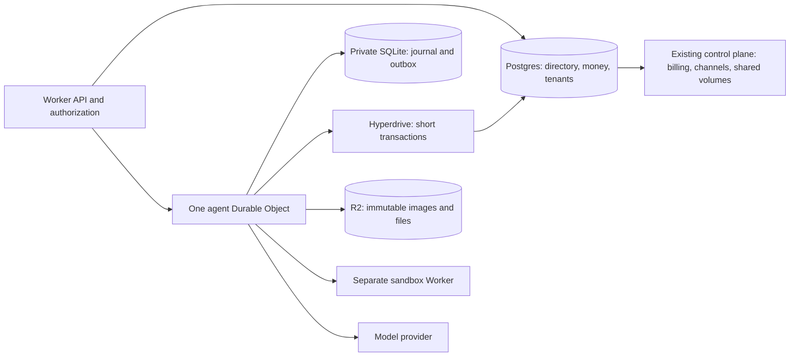

# camelRun hybrid on Workers: design study

**Recommendation: continue a bounded hybrid pilot; do not migrate production yet.**
One Durable Object per agent is a good fit for its journal and execution. Keep
Postgres as the authority for money, tenants, credentials, provider integrations,
usage and administration. The local spike validates real schema transactions
from a DO. It does not prove that a geographically remote DO can cheaply make
many sequential SQL calls, or that the remaining migration is small.

This branch builds on draft [#635](https://github.com/qaml-ai/run/pull/635),
`codex/cf-prototype-2`, source baseline `7d991fe26676`. Read [README.md](../README.md)
and [FEASIBILITY.md](FEASIBILITY.md) for the prototype contract and earlier
measurements. Nothing here changes `src/`, `sandbox/`, `infra/` or main. All
Postgres data used by this study is synthetic and local. Cloud resources are
restricted to the owned `camelrun-proto-*` image experiment and removed afterward.

The October 15 credits outage is a constraint supplied by the CTO for this
study, not a freshly investigated incident. No production database or AWS
operation was used to re-investigate it. The design avoids a D1 money rewrite:
D1 or multiple account/agent DOs would add distributed financial transitions
without making their relational invariants easier to enforce.

The drawing is a proposed target, not a deployed integration. During coexistence,
PG's directory names each agent's backend and generation. An agent DO may cache
configuration, but must not invent tenant authorization or financial authority.
The existing Node control plane continues to run the services that have not been
ported; keeping Postgres does not automatically mean those services can run
unchanged inside a Worker.

The full audit and measured evidence follow in order. Standalone section files
and raw data beside this report support review and reproduction.
