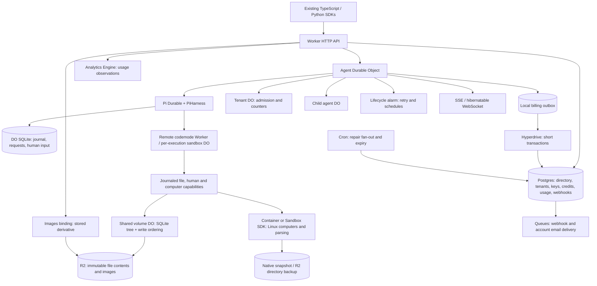

# Workers-native camelRun: the optimistic case

This experiment makes coordination much smaller. An agent is a Durable Object,
not a process whose owner must be discovered. Its journal, request queue, human
input, alarms and live streams share one storage boundary. Postgres remains the
financial authority. Shared files have their own coordination boundary, a volume
DO, while R2 holds immutable bytes.

It is a working local app, not a finished replacement for camelRun. The focused
core flows pass. Existing SDK assertions expose missing contract and policy
coverage. The size comparison below must not be read as a claim that equivalent
functionality shrank by the same percentage.

Built on the work from [#635](https://github.com/qaml-ai/run/pull/635) and
[#644](https://github.com/qaml-ai/run/pull/644). Read the earlier
[feasibility measurements](../cloudflare/docs/FEASIBILITY.md) and
[hybrid study](../cloudflare/docs/HYBRID.md) for the cloud evidence this
experiment builds on. Model and payment tests use local fake providers. The money track also ran a
bounded deployed crypto/DO crash probe; [MONEY.md](MONEY.md) records its scope and
cleanup. There is no new production performance or cost claim.

## Architecture actually implemented

The API resolves tenant-owned agent metadata in Postgres and then calls its
stable DO. There is no global directory DO. Money never moves between financial
DO balances: one Postgres transaction locks the affected accounts. Tenant DOs
admit work; they do not own the credit ledger.

This uses the real schema in `migrations/`. `scripts/reuse-sql.mjs` extracts the
unchanged `postLedger`, `accrueUsage` and end-user credit implementation,
changing only host imports/types. Its check rejects source drift. Those lines
are counted in the Workers implementation. Moving SQL into a different file is
not a saving. `src/calendar.ts` is imported unchanged because its calendar logic
is portable.

## Code size, measured rather than estimated

<!-- SIZE_TABLE -->
| Area | ECS lines / files | Workers lines / files |
| --- | ---: | ---: |
| Accounts, money, webhooks | 10,422 / 40 | 8,803 / 39 |
| Hosting, admission, tenancy | 4,374 / 14 | 369 / 2 |
| Agents, history, schedules | 15,107 / 33 | 1,899 / 4 |
| HTTP, contracts, remaining policy | 13,677 / 69 | 2,923 / 37 |
| Code execution | 797 / 6 | 38 / 2 |
| Files, images, computers | 5,579 / 27 | 1,839 / 7 |
| Total | 49,956 / 189 | 15,871 / 91 |
<!-- /SIZE_TABLE -->

Reproduce with `npm run measure`; inspect every path and count in
[code-size.json](measurements/code-size.json). Units are physical TypeScript
lines, including blanks/comments. Both sides exclude dependencies, declaration
files, tests, docs, Rust and infrastructure. Worker binding declarations
generated by Wrangler are excluded. Generated copies of maintained SQL policy
are included. Each source file is assigned once. Complete files with mixed
responsibilities are counted, so the source baseline includes some console/admin
and service policy that has no equivalent implementation here. The prior
prototype was reused and adapted; it is not counted a second time.

This is a footprint comparison, **not a feature-equivalent deletion estimate**.
The source list explicitly excludes channels, Discord management, voice and
audio transport. Workers counts include its unchanged imports of calendar and
pricing logic. The Linux image additionally contains a 79-line JavaScript parser
and a 5-line Dockerfile, outside the TypeScript table. Missing core features
remain in the denominator and are listed below. In a migration, both
implementations coexist before any old code can be removed.

| Area                    | What became simpler                                                                          | Application concepts still necessary                                             |
| ----------------------- | -------------------------------------------------------------------------------------------- | -------------------------------------------------------------------------------- |
| Agent execution         | One object, Pi journal and Lifecycle recovery replace process startup, IPC and owner routing | Request acceptance, replay rules, bounded history, tools and cancellation        |
| Admission               | One tenant DO serializes durable slots and counters                                          | Quota policy, release/reconciliation, protection against runaway children        |
| History and human input | Journal and durable documents reside beside execution                                        | Projection into the public protocol, paging, input authorization and expiry      |
| Schedules               | DO alarm wakes its owner; no fleet-wide scheduler scan                                       | Calendar rules, stable occurrence IDs and retry behavior                         |
| Delegation              | A child is another named DO; parent records its handle                                       | Child budget/depth policy, cancellation, result/event semantics                  |
| Money                   | Short Hyperdrive transactions reuse relational accounting                                    | Holds, exact ledger invariants, receipt deduplication and financial policy       |
| Webhooks/email          | Queue retries replace a dedicated delivery worker                                            | Transactional delivery intent, signing, endpoint authorization and deduplication |
| Files/images            | Volume DO orders metadata writes; R2 stores immutable bytes; Images transforms               | CAS, path/mount authorization, reachability/GC, derivative policy                |
| Computers               | Platform provisions Linux and lifecycle resources                                            | Command limits, sandbox capabilities, snapshots and uncertain interrupted work   |
| HTTP API                | Direct Worker routing and streamed responses                                                 | Authentication, schemas, error shapes and every compatibility promise            |

### What disappears from this backend

There is no `runtime_nodes` registry, actor-owner discovery, cross-node owner
lease/renewal, ECS task protection, drain/handoff protocol, parking manager,
agent subprocess, IPC framing, process supervisor, warm process pool, process
memory retirement, `LISTEN/NOTIFY` wakeup bus, node capacity scheduler, or
polling fleet scheduler. Volume writes need no owner lease, heartbeat,
replicated log folding or node routing. Stable DO addressing and platform
execution replace them. The real Postgres schema is deliberately unchanged, so
legacy tables still exist in the local database; they are unused by this path,
not dropped by this PR.

Not every outbox disappears. A tiny DO billing outbox bridges SQLite to
Postgres. Financial transactions record webhook/email intent in Postgres so a
crash before Queue publication is repairable. Queues own transport retry, not
the atomicity of a Postgres write plus a queue send. Pretending this boundary
disappeared would make the diagram shorter and the accounting incorrect.

## What is tested

The focused suite starts actual workerd, not an in-memory imitation of a DO. API
fixtures have fresh local Postgres databases with all 112 migrations. The
computer smoke also uses its own migrated, funded local fixture. SQLite, R2,
alarms, remote codemode and queue consumers run locally. The deterministic
provider exercises real Pi conversations and tools without a model credential.

- Agent creation/keyed upsert, request idempotency, message, SSE deltas and
  history.
- Human input survives a hard kill/restart; the same pending input resumes.
- An alarm submits a scheduled occurrence; a parent creates a durable child.
- Remote codemode writes and reads files through the real ordered volume tools.
- Turn completion commits with a billing intent; restart after PG commit applies
  one debit, releases its hold, and acknowledges the durable intent.
- Independent charges contend for one account without overspending; rollback,
  changed receipt rejection, hold visibility and team transfer idempotency.
- Existing end-user credit lot expiry and idempotent transactions.
- API-key creation, tenant isolation and revocation.
- Four concurrent cross-tenant agent-ID takeover attempts are rejected without
  changing the owner's configuration or credentials. Unaccepted quota refusals
  never execute on recovery.
- Queue delivery reaches a real local HTTP receiver with a verifiable signature;
  account-email verification uses a single-use expiring link and local delivery.
- Concurrent volume CAS has one winner; byte ranges, immutable snapshots and
  metadata survive restart; capability tampering is refused.
- Images transforms/caches a derivative, produces an expiring URL or bounded
  base64, and retains only a compact immutable reference in Pi history.
- Both Linux providers execute commands and file operations, block arbitrary
  Internet access, and restore saved content after destruction. These are local
  Docker runs, not new claims about cloud cold starts or snapshot latency.

The image design follows option (c) from HYBRID: immutable original and stored,
versioned derivative in R2; signed URL delivery; a bounded fallback for a
provider that requires base64. The stock Pi adapter currently uses that
fallback. URL preparation and signed download are tested, but URL vision
acceptance by a live provider is not. Input/derivative and aggregate limits
reduce memory pressure. Uploads buffer up to 32 MiB; these bounds do not
establish a maximum for every list, snapshot or model-context path.

## Public API compatibility scorecard

<!-- SCORECARD -->
The final inventory has **146 cases: 50 pass, 57 fail, 39 not applicable**. Of the passes, **5 reach workerd** and **45 are SDK-only unit checks**.

| Original test file | Worker pass | SDK-only pass | Fail | N/A |
| --- | ---: | ---: | ---: | ---: |
| `tests/api.test.ts` | 0 | 0 | 0 | 18 |
| `tests/cli-api.test.ts` | 0 | 1 | 0 | 0 |
| `tests/computers-api.test.ts` | 0 | 0 | 7 | 0 |
| `tests/decisions-api.test.ts` | 0 | 0 | 5 | 0 |
| `tests/image-generation-api.test.ts` | 0 | 0 | 3 | 0 |
| `tests/image-generation-sdk.test.ts` | 0 | 0 | 1 | 0 |
| `tests/openapi-sources.test.ts` | 0 | 0 | 2 | 0 |
| `tests/openapi.test.ts` | 0 | 0 | 0 | 1 |
| `tests/python_sdk.py` | 3 | 26 | 29 | 2 |
| `tests/schedule-api.test.ts` | 0 | 0 | 1 | 2 |
| `tests/sdk-lazy-connections.test.ts` | 2 | 0 | 2 | 0 |
| `tests/sdk-multi-agent.test.ts` | 0 | 0 | 1 | 0 |
| `tests/sdk-portable.test.ts` | 0 | 10 | 0 | 0 |
| `tests/sdk-server.test.ts` | 0 | 8 | 1 | 0 |
| `tests/service-api.test.ts` | 0 | 0 | 0 | 4 |
| `tests/speech-api.test.ts` | 0 | 0 | 0 | 2 |
| `tests/transcription-api.test.ts` | 0 | 0 | 0 | 3 |
| `tests/transcription-sdk.test.ts` | 0 | 0 | 0 | 1 |
| `tests/ui-ai-sdk.test.ts` | 0 | 0 | 5 | 0 |
| `tests/voice-api.test.ts` | 0 | 0 | 0 | 6 |
<!-- /SCORECARD -->

[compatibility.json](measurements/compatibility.json) records pass, fail or
not-applicable for each inventoried case; adjacent TAP and Python logs preserve
the assertions and failures. A pass from a pure SDK unit test is explicitly
separate from a pass against workerd. Not-applicable is never counted as pass.

The TypeScript loader replaces only `tests/runtime-server.ts`'s server fixture.
Original test bodies, assertions and HTTP fake-model behavior run unchanged. The
Python runner imports `tests/python_sdk.py` and redirects its Node server
subprocess to a local Workers host. It does not rewrite expected outcomes. Tests
which directly construct Node services, inspect the Node schema generator, or
invoke their own ECS fixture cannot target a base URL unchanged; their rows
explain that harness limitation. Voice/audio cases are outside the requested
scope.

The final pass also attempted the image-generation API/SDK, UI SDK, and the
HTTP-only schedule case through that shared fixture. Their original test bodies
and assertions are unchanged. The other two schedule cases remain N/A because
they construct Node account services or mutate the Node scheduler's SQL table.
Supplied fixture token hashes are seeded into local tenants, and loopback
streaming-provider URLs are honored. The adapter does not reproduce every Node
tenant-policy setting, so failure details can also expose fixture limitations.

The remaining gaps include attached SDK/MCP tools, remote MCP/OpenAPI source
management, definitions, stateless runs, fork/import/export, structured output,
complete model options, public computer-provider APIs and complete file/archive
semantics. Channels and voice are deliberately excluded.

The [money track](MONEY.md) adds source account/authentication, key/secret,
credit-hold, model-attempt, subject/workspace, Stripe test-mode and outbox policy.
Its independent money scorecard and explicit remaining gaps are in that report.
The original compatibility total above is unchanged: billing adjustments now
pass, but the four image cases still fail at the upload/generation route. The
five UI cases receive no assembled assistant message. Full paid-runtime parity
is not established by these narrower passing service tests.

## Platform choices

| Platform piece                | Use in this app                                                                                                                                                       |
| ----------------------------- | --------------------------------------------------------------------------------------------------------------------------------------------------------------------- |
| DO SQLite and alarms          | Agent journal/state, tenant admission, volume ordering; Lifecycle shares the agent alarm with schedule/retry jobs                                                     |
| Hyperdrive/Postgres           | Directory and relational authority; short-lived `pg` clients, no session locks or transactions across model calls                                                     |
| R2 and Images                 | Immutable contents, snapshots/backups and bounded stored image derivatives                                                                                            |
| Queues and Cron               | Delivery plus repair of the SQL-to-Queue publication gap and periodic expiry                                                                                          |
| Containers / Sandbox SDK      | Optional Linux exec, files, parsing and persistence tests                                                                                                             |
| Hibernatable WebSockets / SSE | Native WebSocket API is available; SDK compatibility uses SSE, which remains active while open                                                                        |
| Analytics Engine              | Optional observation, never financial authority; local plumbing only, not a queried production dashboard                                                              |
| Rate Limiting binding         | Optional fast HTTP throttle hook; durable tenant admission remains authoritative; no real cloud binding is provisioned                                                |
| Secrets Store                 | No real credentials are needed locally. No Secrets Store resource is created; production secret distribution and rotation remain work                                 |
| Workflows                     | Not used: the tested wake, tool and delivery operations fit Pi/Lifecycle, alarms and Queues. A cross-service account export/deletion job may justify a Workflow later |
| D1                            | Not used: DO SQLite already supplies local state; adding a second relational financial store makes this experiment less simple                                        |

## Where the optimism hides risk

**DO-to-Postgres is a distributed boundary.** A durable request intent precedes
reservation and Pi submission. Terminal request state and billing intent commit
locally together, then a stable receipt settles under a Postgres account lock.
Only after commit is the intent acknowledged. Tests kill workerd after that
commit and observe one debit. Transaction rollback and duplicate/changed
receipts are also tested. This does not simulate every network failure during
COMMIT, a whole region outage, or an external provider accepting a request
before returning its receipt. Unknown provider outcomes need reconciliation; an
expired hold alone cannot justify a refund. Pricing/reservation ceilings and all
policy interactions need qualification before paid production work. Provider
attempts now use the source's real estimates, mutable holds and stream policy;
there is no fixed $0.01 turn reservation. Active-runtime metering, every tool
path and exact budget-reset attribution still need the work listed in MONEY.md.

**Native fetch cannot pin the approved DNS result.** The money adapter retains
source address, redirect, deadline and response-size checks, but the Worker
transport resolves separately. A deployment needs a compatible egress boundary
before allowing untrusted tenant endpoints.

**Many DOs can overwhelm one database.** Local Hyperdrive is a direct
connection, not its production pool/cache. See
[local-mode semantics](https://developers.cloudflare.com/hyperdrive/configuration/local-development/).
Fresh per-operation clients prevent idle pinned sessions, but sequential SQL
round trips, regional placement, pool queueing, tenant hot spots and
reconnection storms remain. The documented
[Hyperdrive limits](https://developers.cloudflare.com/hyperdrive/platform/limits/)
and origin pool sizing need a regional fan-out load test. No real Hyperdrive
proxy or production database was touched. The original URL-level schema
isolation failed locally and was replaced by separate test databases; this is
retained as a testing lesson, not hidden in a passing mock.

**128 MB is a real design constraint.** The previous cloud experiment measured
about 61.27 MiB for a 10k-message loaded context, while a 50k context exceeded
the limit and was replaced. These are prior measurements, not repeated here. The
[DO limit](https://developers.cloudflare.com/durable-objects/platform/limits/)
is per isolate. Bounded HTTP history and image hydration reduce one source of
pressure; they do not solve Pi's resident context, compaction, huge tool results
or colocated-object pressure. Request records are retained without pruning, and
state/recovery scan them. This backend caps history materialization and fails
explicitly beyond its bound; it does not yet provide the complete large-history
paging/export implementation.

**Idle SSE is not hibernation.** Native hibernatable WebSockets can avoid idle
DO duration, but existing SDKs use SSE. Those open streams can retain an active
object. See
[Cloudflare's WebSocket guidance](https://developers.cloudflare.com/durable-objects/best-practices/websockets/).
Do not multiply a hibernating-agent price by an SSE-heavy workload. Lazy SDK
handles and reconnect semantics matter at least as much as dropping the
supervisor.

**Cost depends on active duration, SQL and computers.** No new cloud resources
were deployed: new cloud spend is $0; prior experiment spend remains
approximately $5, as supplied in the task. There are no cloud snapshots to
retain from this run. The earlier measured marginal model was $0.00576 per
continuously active DO-hour, from `0.128 GB * 3600 * $12.50 / 1e6`; current
[DO pricing](https://developers.cloudflare.com/durable-objects/platform/pricing/)
should be checked again before procurement. At those rates, an illustrative
10,000 continuously active agents cost about $41,472 per 30-day month in DO
duration alone; an equally active remote sandbox per agent doubles it. This is a
scenario, not our measured traffic or an invoice. Short bursts with hibernation
can be much cheaper. Add SQL writes/reads, R2, Images, queue operations,
Hyperdrive, origin Postgres, model tokens and Linux duration. We did not read
production usage or current AWS spend, so there is no defensible net monthly
saving claimed here.

**Workerd is not self-hosted Cloudflare.** The API and JS runtime can run
locally; managed DO placement, replicated storage, hibernation, Queue delivery,
Images, Hyperdrive and container orchestration are platform services.
Reproducing their semantics on self-hosted workerd requires adapters and
operations. Postgres and R2's object model improve data portability, but the
coordination implementation is intentionally vendor-specific. Lock-in buys the
simplicity demonstrated here.

**Migration is a product project.** Existing Postgres agent history must be
exported with stable IDs, imported into Pi/DO storage, compared, and fenced
before routing changes. Parent/child links, outstanding human inputs, scheduled
occurrences, pending bills, file references and secrets all need a cutover plan.
Keep the old owner unable to execute effects after switching the directory
generation. No migration, restore, production write or main-branch change is
performed here. Physical erasure/GC, key rotation, retained snapshots and
rollback need their own verification; the prototype does not erase them by
inference.

## Verdict

The optimistic case is credible for coordination: stable entities, local
journals, alarms and managed delivery remove entire host-level mechanisms.
Keeping money in Postgres is compatible with that simplicity, provided the small
distributed seams are explicit and tested. The experiment is a good architecture
prototype and a poor justification for an immediate replacement announcement.
Finish the API and policy gaps, then measure real Hyperdrive fan-out,
idle-stream economics and a fenced migration before deciding whether the
operational savings justify lock-in.

## Original prototype reproduction and cleanup record

This is the record before the money track. The current account/money checks,
cloud probe, cleanup and remaining differences are in [MONEY.md](MONEY.md) and
[money-validation.json](measurements/money-validation.json).

From `backends/workers/`, the original checks were:

| Command                                                          | Result                                                                                    |
| ---------------------------------------------------------------- | ----------------------------------------------------------------------------------------- |
| `npm install --no-audit --no-fund`                               | Isolated locked dependencies installed; UI SDK test dependency pinned to the root version |
| `node scripts/local-postgres.mjs`                                | 112 migrations applied to isolated local Postgres                                         |
| `npm run types`                                                  | Wrangler binding declarations generated                                                   |
| `npm run typecheck`                                              | Pass                                                                                      |
| `node scripts/reuse-sql.mjs --check`                             | Exact financial source reuse confirmed                                                    |
| `npm test`                                                       | 4 passed                                                                                  |
| `npm run test:integration`                                       | 24 passed, including real workerd restarts and both Docker computers                      |
| `npm run build`                                                  | Both Worker dry-run bundles passed; nothing published                                     |
| `python3 scripts/python-compat.py`                               | 60 original tests: 29 passed, 29 failed/error, 2 excluded voice/audio cases               |
| `npm run test:compat`                                            | 146-case scorecard; 50 pass, 57 fail, 39 N/A; exits nonzero for remaining failures        |
| `node scripts/report.mjs`                                        | Reproduced size and scorecard tables                                                      |
| Root `npm run docs` plus anchored `llms.txt` freshness/link test | Pass; no root documentation changes                                                       |
| `node scripts/local-postgres.mjs --stop`                         | Prototype Postgres removed                                                                |

The final unit, integration, build and compatibility logs are in
`measurements/`. The initial broken schema-isolation fixtures were replaced and
affected suites rerun; their counts are not included. The compatibility
inventory can be rebuilt from existing logs with
`COMPAT_REUSE_RESULTS=1 npm run test:compat`; that mode does not rerun tests.

All owned test processes and computer containers were stopped. The prototype
Postgres container and leftover temporary fixture directories were removed. The
unrelated `cutover-pg` container was left alone. Normal local npm/Docker build
caches remain; there are no retained Cloudflare resources or cloud snapshots
from this run. New Cloudflare spend: $0.
