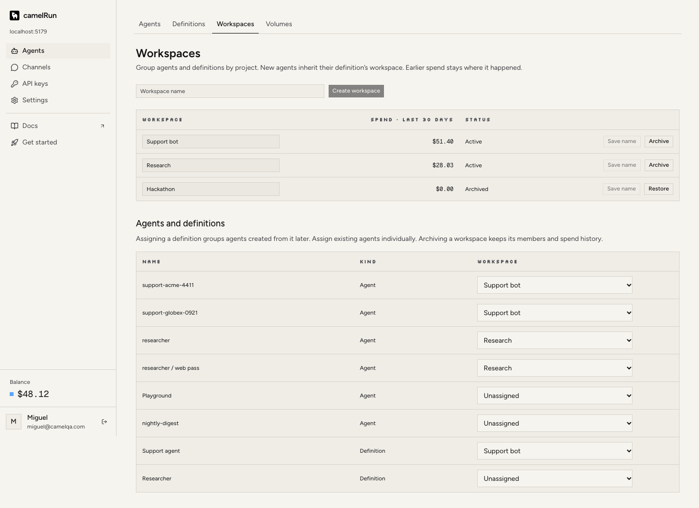
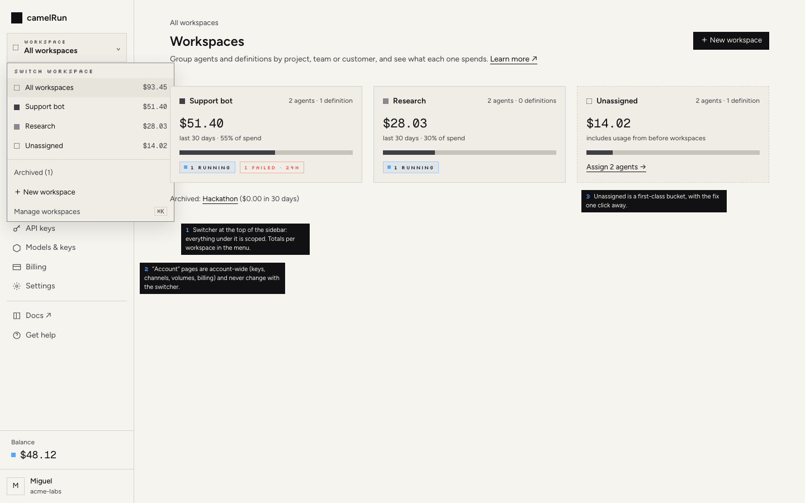
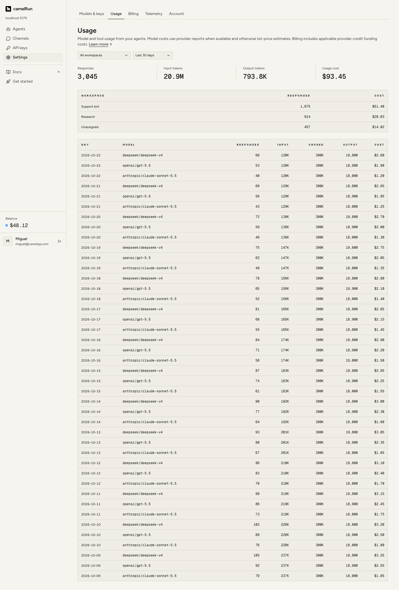
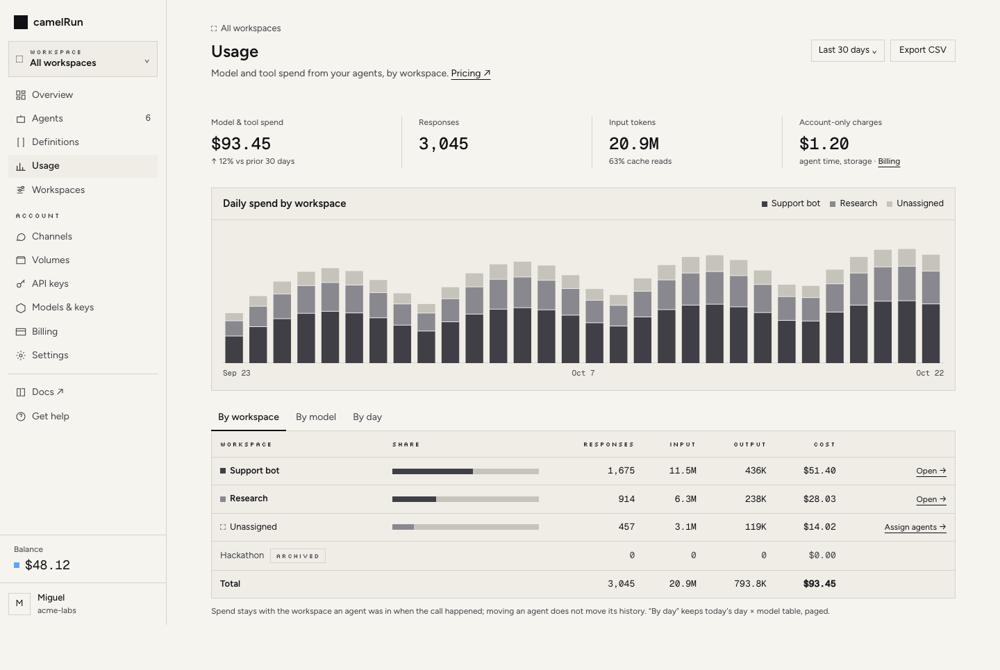
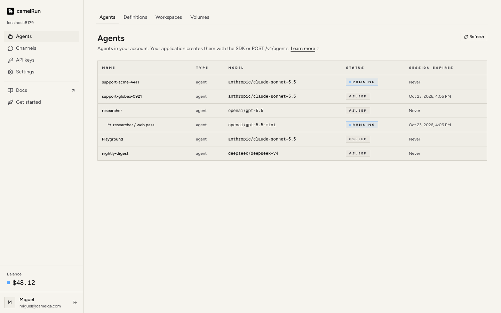
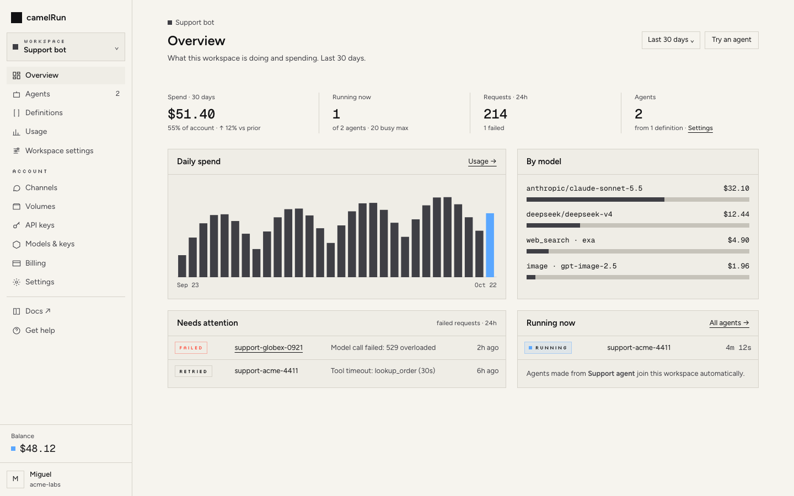

# Console redesign: workspaces as the organizing idea

Phase 1 proposal: an audit, two options, a recommendation with mockups, and a PR-sized plan.
No app code changes here. Screenshots of today's console are in `screenshots/current/` (taken from
`vite dev` against a fixture API: six agents, two definitions, three workspaces, 14 days of usage).
To reproduce the current screenshots: `node console/design/redesign/tools/mock-api.mjs` (listens on 8790, where
`console/vite.config.ts` proxies `/v1`), then `npx vite --config console/vite.config.ts`.
Mockups are static HTML in `mockups/` (open `01-shell.html`; the sidebar links them) using the
console's real tokens and Silkscreen; their screenshots are in `screenshots/proposed/`.

| Today | Proposed |
| --- | --- |
|  |  |
|  |  |
|  |  |

More: `screenshots/proposed/03-agents.png`, `05-workspace-settings.png`.

## What a workspace is today (server, #396)

- **Scopes:** agents and definitions (assignment, with history), and **model and tool spend**
  (`workspace_usage`, attributed at call time). New agents inherit from their definition; forks and
  sub-agents from their parent. `GET /v1/usage?workspaceId=` filters, and the account response
  carries a `workspaces` summary with an Unassigned bucket.
- **Does not scope:** API keys, provider keys / key scopes, channels, volumes, schedules, webhooks,
  telemetry, billing, active-time and storage charges, and people (an account is one sign-in; there
  are no members).
- So a workspace is a **lens over agents, definitions and spend**, not a tenant or a permission
  boundary. Any design that pretends otherwise (a switcher that seems to scope API keys) would
  mislead.

## Audit

### Pages and nav today

| Nav place | Tabs / pages | Shows | Workspaces? |
| --- | --- | --- | --- |
| Get started (until a path is done, then under Docs) | `/start`, Discord path, code path | first-run hero, two use-case starts, playground | no |
| Agents | Agents · Definitions · **Workspaces** · Volumes | agents table (name, type, model, status, expiry); definitions editor; workspaces admin; volumes | only on its own tab |
| Channels | one page | Slack/Telegram/Discord/GitHub/webhook channels | no (though a channel's agents inherit its definition's workspace) |
| API keys | one page | tokens, connected OAuth apps | no (correctly: keys are account-wide) |
| Settings | Models & keys · **Usage** · Billing · Telemetry · Account | provider keys and models; usage stats + workspace table + day×model table; balance, tier, auto top-up; OTLP export; export/delete | Usage has a workspace filter |
| (home `/`) | Get started with no agents, else the Agents list | | no |
| Agent detail | Conversation · Requests · Try it · Files · Configuration · Schedules | | no |

### Problems

1. **Workspaces are bolted on.** They live as the third tab of Agents and a filter on Usage
   (`05-workspaces.png`, `10-usage.png`). Nowhere else knows about them: the agents list has no
   workspace column or filter, agent detail does not show or change its workspace, definitions do
   not show theirs, and channels do not say where their agents land.
2. **The Workspaces page is a bulk form, not a place.** One table renames inline (an input and a
   "Save name" button per row), another lists every agent and definition with a native `<select>`
   (the OS control, against DESIGN.md's square controls). With hundreds of per-conversation agents
   (the normal camelRun shape: one per chat, PR or key) it becomes a page-long wall of dropdowns.
   There is no workspace detail page, no counts, and no way to see a workspace's agents together.
3. **No home for an active account.** After the first agent, `/` is the Agents list. Nothing
   answers "what is running, what failed, what am I spending, and where". Spend lives two levels
   down under *Settings → Usage*; failures exist only per agent (Requests tab).
4. **Usage is under Settings.** Usage and Billing are what people come back for; Settings is where
   things are set once. Usage's day×model table is unbounded (90 days × N models is hundreds of
   rows), has no chart, and the workspace choice is not written back to the URL (a reload or a
   shared link loses it, though `?workspaceId=` is read on load).
5. **Grouping is by object type, not by job.** "Agents" groups Agents, Definitions, Workspaces and
   Volumes; "Settings" mixes configuration (models, telemetry), money (usage, billing) and identity
   (account). Volumes are account resources; Workspaces are the organizing layer above Agents, not
   a peer tab of it.
6. **"Workspace" means two things.** The API and docs also call each agent's filesystem its
   "workspace" (`/workspace`, `WorkspaceMount`, "workspace volume"). The console should say
   **Files** for the filesystem everywhere and keep "workspace" for the grouping.
7. **Lists will not scale.** `GET /v1/agents` returns every agent unpaged and the shell polls it
   every 10 s on `/`; the Workspaces page loads all agents, definitions and memberships at once.
   No search, no status filter.
8. **Smaller inconsistencies.** Dense status-only agents table (`Type` is always "agent"); Agent
   detail's tabs use the pill `Tabs` while sections use underline link tabs; empty Usage sends people
   to Get started even on a mature account; Telemetry, a developer integration, sits beside Account.

## Options

### A. Hard switcher: workspace as the context for everything

Everything under the switcher is filtered to the workspace, including channels, volumes, schedules
and API keys, like Vercel teams or OpenAI projects.

- **For:** one mental model; ready for members and per-workspace keys later.
- **Against:** needs server work first (workspace ids on channels, volumes, tokens, key scopes,
  webhooks; inheritance rules for each), and today it would be a lie: an API key works on every
  workspace. Becomes "projects with permissions", a product decision, not a console one.

### B. Workspace lens + account section (recommended)

A switcher at the top of the sidebar with *All workspaces*, each workspace and *Unassigned*. It
scopes **only what the server scopes**: Overview, Agents, Definitions, Usage and that workspace's
settings. A second sidebar group, **Account**, holds what is account-wide and never changes with the
switcher: Channels, Volumes, API keys, Models & keys, Billing, Settings (Telemetry, Account).

- **For:** honest to the data model; ships on today's API (one small server step, below); "All
  workspaces" keeps single-project accounts exactly as simple as now (an account with no workspaces
  shows no switcher at all); grows into A if workspaces later gain keys or members, by moving items
  from the Account group up.
- **Against:** two kinds of pages; the group label has to carry that. Mitigated by the switcher's
  position (it visibly sits above only the scoped group) and the breadcrumb on scoped pages.

**Recommendation: B.** Revisit A only if workspaces get members or keys.

## Recommended IA (option B)

```
[camelRun]
[WORKSPACE ▾ Support bot]        ← hidden until the account has a workspace
  Overview                        /console/            (?ws=… on every scoped URL)
  Agents          2               /console/agents
  Definitions                     /console/definitions
  Usage                           /console/usage
  Workspace settings              /console/workspaces/:id   ("Workspaces" index when All)
ACCOUNT
  Channels · Volumes · API keys · Models & keys · Billing · Settings (Telemetry, Account)
──
  Docs ↗ · Get help · Get started (while in progress: with its n/m, at the top, as today)
[Balance]  [Miguel · acme-labs]
```

- **Selection lives in the URL** (`?ws=ws_…|unassigned`, absent = All) and is remembered per
  browser; links between scoped pages carry it. Every old URL keeps working.
- **Overview** (`02-overview.png`) is the home once an account has an agent: spend for the range
  (with share of account and change vs the prior period), running now vs the busy-agent limit,
  requests and failures in 24 h, daily spend chart, spend by model/tool, *Needs attention* (failed
  requests) and *Running now*. With no agents, home stays Get started (DESIGN.md's first moment).
- **Agents** (`03-agents.png`): search, status chips (Running, Failed, Sub-agents, Expiring), a
  Workspace column when All is selected, multi-select with **Move to workspace**, "Assign…" inline
  for unassigned rows. Agent detail shows its workspace in the header with a Move control.
- **Usage** (`04-usage.png`): moved out of Settings. Stats, a daily spend chart stacked by
  workspace (monochrome ramp; signal blue stays status-only), then tabs *By workspace* (with share
  bars, Unassigned and archived rows, a total), *By model*, *By day* (today's table, paged).
  Account-only charges (agent time, storage) shown beside it so the numbers reconcile with Billing.
- **Workspaces index** (`01-shell.png`, All selected): one card per workspace with spend, share,
  counts and running/failed badges; Unassigned as a dashed card with "Assign n agents"; archived
  collapsed to a line.
- **Workspace settings** (`05-workspace-settings.png`): name, id (copyable, for `workspaceId`),
  definitions (with the channels that use them), agents with Move, archive/restore at the bottom.
- **Definitions and Channels**: definitions show and set their workspace; a channel shows the
  workspace its agents join (through its definition), read-only.
- **Copy:** "Files" for the agent filesystem everywhere in the console; "workspace" only for the
  grouping.

Visual language stays DESIGN.md's: square, monochrome, Figtree/Geist Mono/Silkscreen, no art on
working surfaces. Two additions to DESIGN.md: (1) workspace swatches are the gray ramp
(`--chart-3`, `--chart-2`, `--chart-4`, then hatched), never a hue, so signal blue keeps meaning
"live"; (2) charts are allowed on Overview and Usage, as plain bars in `border bg-card` frames.

## Implementation plan

Each step is one PR, behind no flag (each is useful alone), with `npm run test:console` and a local
`vite` check before pushing. Test files are `console/test/*.test.tsx` (fetch stubbed, as
`workspaces.test.tsx` does).

1. **Nav and shell restructure** (no API change). `web/lib/nav.ts` becomes two groups (`WORKSPACE`,
   `ACCOUNT`) plus footer links; Usage moves out of Settings; Workspaces leaves the Agents tabs.
   `web/main.tsx` renders the groups and routes `/workspaces/:id`. Old URLs stay. Update
   DESIGN.md's *Structure*. Tests: a new `nav.test.tsx` for group membership and that every old
   section still resolves.
2. **Workspace context + switcher.** New `web/lib/workspace.ts` (`useWorkspace()`: read/write
   `?ws=`, localStorage fallback in try/catch, `Link` carries it) and
   `web/components/workspace-switcher.tsx` (a new Radix `ui/popover.tsx`, square, with a list, per-workspace
   30-day totals from `/v1/usage`'s `workspaces`, New workspace, Manage). Hidden when the account
   has none. `web/lib/router.tsx` learns to keep `ws`. Tests: switching rewrites the URL; archived
   are grouped; no switcher with zero workspaces.
3. **Workspaces index + settings pages.** Rewrite `web/pages/workspaces.tsx` into the index cards
   and a `WorkspaceSettingsPage` (rename, members via `GET /v1/workspaces/{id}/members`, add
   agents/definitions dialog, archive/restore). Drop the dropdown wall. Update
   `console/test/workspaces.test.tsx` to the new flows (create, rename, add agent, archive).
4. **Scoped Agents, Definitions, agent detail.** `pages/agents.tsx`: workspace column, filter by
   context (client-side join with `/v1/workspace-memberships` for now), search, status chips,
   multi-select Move (one `PUT /v1/workspace-memberships/agent/:id` per agent). `pages/agent.tsx`:
   workspace in the header with Move; rename the Files copy. `pages/definitions.tsx`: workspace
   field. `pages/channels.tsx`: read-only "agents join …". Tests: `agents-nested.test.tsx` extended;
   new `agents-workspace.test.tsx`.
5. **Server: list endpoints that scale** (`src/api.ts`, `src/api-schemas.ts`, `openapi.json`,
   clients). `GET /v1/agents` gains `workspaceId`, `q`, `status`, `limit`/`cursor`, and returns
   `workspaceId`, `lastActiveAt` and `lastError` (latest failed request, if any) per agent;
   `GET /v1/definitions` returns `workspaceId`. Then step 4's client join goes away. Tests in
   `tests/workspaces.test.ts` and the agents list tests; regenerate the SDK types.
6. **Overview page.** New `web/pages/overview.tsx` + `web/components/charts.tsx` (plain SVG bars,
   tokens only). Uses `/v1/usage?workspaceId=` (current and prior period), `/v1/agents?status=running`,
   `/v1/billing` (busy limit). *Needs attention* needs a small server addition:
   `GET /v1/requests?state=failed&since=&workspaceId=`. Request records live in each agent's session
   state (`client-sessions.ts`), not a queryable table, so this needs a small `request_failures`
   table (tenant, agent, request, error, at; pruned after 7 days) written where a request's outcome
   becomes an error. Ship the page without that panel if the endpoint lags. Home routing
   in `main.tsx`: Get started while no agents, Overview after. Tests: `overview.test.tsx`; update
   `start.test.tsx` for the home switch.
7. **Usage rework.** `pages/usage.tsx`: context-driven (no own workspace select), chart stacked by
   workspace, By workspace / By model / By day tabs, paged day table, account-only charges from
   `/v1/billing`'s `month`, URL state for range and tab, CSV export of the current view. Optional
   server: `GET /v1/usage?groupBy=agent` for top agents (needs agent-level attribution rows, which
   `workspace_usage` does not keep; skip unless asked). Tests: rewrite the usage half of
   `workspaces.test.tsx` into `usage.test.tsx`.
8. **Polish and docs.** Agent detail tabs to the underline style; `EmptyState` copy per scoped page
   ("No agents in Support bot yet: assign some or create one with workspaceId"); update
   `docs/guides/workspaces.md` (console paths) and DESIGN.md (swatches, charts, two nav groups).

Server work is limited to steps 5 and 6: one list endpoint extended (plus whatever index its
`lastActiveAt`/`status` filters need) and one read endpoint with its small `request_failures` table.
